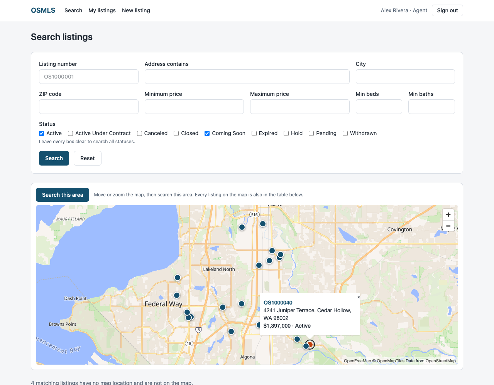

# OSMLS

An open-source MLS platform, created by Daniel P. Harris.

OSMLS is a focused core MLS: the functions people need for everyday work, built as
complete, tested workflows rather than a long list of unfinished features. It is not
an attempt to match the feature set of commercial MLS systems.

## Status

**Version 0.1, in development. Not production-ready.**

- It has not been used by a real MLS and has had no security review.
- It is **not RESO certified** and has not been run through RESO's certification
  tests. Its field names and lookup values follow the RESO Data Dictionary 2.1.
  Data types have not been checked against the Data Dictionary, and there is no
  RESO Web API endpoint yet.
- All people, offices, and listings in the demo are synthetic.

[CHARTER.md](CHARTER.md) records the project's purpose, decisions, scope, and what
remains.

## Screenshots

From the demo, which uses synthetic listings and illustrated placeholder photos.

**An agent searches listings**


**Map search** (added after 0.1)



**A listing, as MLS staff see it**


**Its change history, including a staff correction**


## Creator and maintainer

OSMLS is created and maintained by [Daniel P. Harris](https://danielpharris.com)
([GitHub](https://github.com/DanielPHarris)). Daniel held senior leadership roles at
Las Vegas REALTORS®, including Chief Technology Officer, Chief Innovation Officer,
and Chief Operating Officer, and served in interim CEO leadership. That experience
in technology and operations leadership shapes OSMLS's priorities: practical agent
workflows, MLS administration, interoperability between vendors, and systems that
keep an accountable record of who changed what.

OSMLS is an independent project. It is not affiliated with or endorsed by Las Vegas
REALTORS® or the Real Estate Standards Organization (RESO).

## What version 0.1 does

One workflow, end to end:

1. **An agent creates a listing.** Required fields and formats are validated. Only
   permitted status changes are allowed. Photos can be uploaded.
2. **Another agent finds it.** Search by listing number, address, city, ZIP code,
   price range, bedrooms, bathrooms, and status, then open the full listing.
3. **MLS staff inspect its history.** Every change records who made it, when, the
   field, and the old and new values. Staff can correct any listing, but must give a
   reason, and the correction is marked as such.

Rules behind it:

- A listing agent can change only their own listings, and not once a listing is
  Closed, Canceled, or Expired. After that, only a staff correction can change it.
- History is written in the same database transaction as the change it describes.
  The database refuses any attempt to edit or delete a history row.
- Photos and listings are visible only to signed-in, active members.

### Added since 0.1: map search

- **Pin a listing.** On the listing form, click the map to place a pin or drag it to
  move it. Latitude and longitude fields show the same position and can be typed
  instead. A location is optional, but it is both coordinates or neither. Changes
  are recorded in the listing's history.
- **See results on a map.** The search page shows a pin for each matching listing
  that has a location. Selecting a pin shows the address, price, and status, with a
  link to the listing. Pins can be reached and opened from the keyboard, and every
  listing on the map is also in the results table.
- **Search this area.** Limits results to the part of the map on screen, together
  with every other filter. The area is kept in the page address, so a search can be
  reloaded or shared with another member.
- **Listings with no location** appear in ordinary searches marked "Location
  unavailable". An area search leaves them out, and says how many, because they
  cannot be placed inside the area.
- **If the map cannot be loaded,** the search form, the results table, and the
  listing form all keep working, and the page says the map is unavailable.

Not included: drawing shapes or radius circles, turning an address into a location
automatically, boundary layers, and map areas that cross the 180th meridian.

#### The map service

The map is drawn with [MapLibre GL JS](https://maplibre.org/). Where the map itself
comes from is one setting, `MAP_STYLE_URL`, which takes any MapLibre-compatible
style URL.

- If it is not set, OSMLS uses [OpenFreeMap](https://openfreemap.org/)'s public
  service, which needs no account or key. **That service comes with no availability
  guarantee and may be discontinued without notice.** It is a default for demos.
  Anyone running OSMLS for real use should choose a map tile service suited to
  their needs, self-hosted or managed, and set `MAP_STYLE_URL` to it.
- The map's credit line comes from the style (for the default: OpenFreeMap,
  OpenMapTiles, and OpenStreetMap) and is always shown in full. Keep it.
- When a member views a map, their browser requests map tiles directly from the
  map service. No listing data is sent to it.
- In the demo data, the towns are invented and pins are arbitrary points. They do
  not mark real properties.

### Added since 0.1: documents and showing instructions

Both carry information that not every member should see, so each has access rules,
enforced on the server in one place ([src/lib/access.ts](src/lib/access.ts)).

**Who is who.** "Listing office" is the one office named on the listing, not the
whole brokerage. "MLS staff" is an active account that holds the staff role. A
suspended (inactive) account can do nothing, whatever its role. Anything the tables
below do not allow is refused.

**Documents.** Each document has one permission. A new document starts at the most
restrictive.

| Permission | Who can view and download |
| --- | --- |
| Listing agent only (the default) | The listing agent and MLS staff |
| Listing office only | The listing agent, agents in the listing office, and MLS staff |
| All MLS members | Any active member |

- The listing agent can add, rename, replace, and delete documents and change their
  permission, until the listing is Closed, Canceled, or Expired. MLS staff can at
  any time, as a correction with a reason.
- PDF, JPEG, and PNG only, identified by the file's content, up to 15 MB each and
  25 per listing. The limits are in
  [src/lib/rules/local.ts](src/lib/rules/local.ts).
- Files are kept in a folder nothing serves directly, under generated names. The
  only way to one is a download route that checks access on every request and
  always sends the file as a download.
- A document someone may not see is left out of what they are sent, and asking for
  it directly gets the same "not found" as a document that does not exist.
- Replacing or deleting a document destroys the old file. History keeps its name,
  type, size, and SHA-256 hash, but not its contents.

**Showing instructions.** Instructions, requirements, a contact, and lockbox type
and location.

| Listing status | Who can view |
| --- | --- |
| Coming Soon, Active, Active Under Contract, Pending, Hold, Withdrawn | Any active member |
| Closed, Canceled, Expired, and any other status | The listing agent, agents in the listing office, and MLS staff |

Showing details never appear in search results.

**Limits you should know about**

- **Files are not scanned for malware.** Checking that a file is a PDF or an image
  says what type it is. It does not show the file is safe to open, PDFs included.
- **Entry codes are a usage restriction, not a guarantee.** OSMLS has no field for
  lockbox combinations or gate codes, and the forms tell agents not to enter them.
  Nothing stops someone typing a code into free text or uploading a file that
  contains one.
- No earlier versions of a replaced document are kept.
- There is no record of who viewed or downloaded a document.
- Files are stored on local disk only.
- Change history, which describes documents by name, is visible to MLS staff only.
- There is no export. Any added later must use the same access rules.

### Added since 0.1: market research

Sold search, days on market, and comparables.

**Days on market are a policy, not a fact.** The RESO Data Dictionary defines both
days on market (DOM) and cumulative days on market (CDOM) only as "defined by the
MLS business rules", so figures from different MLSs are not comparable. OSMLS does
not pick one policy for everyone. It ships defaults, each a named setting in
[src/lib/rules/market-time.ts](src/lib/rules/market-time.ts):

| Setting | What it decides | Default |
| --- | --- | --- |
| Statuses that accumulate days | The one list of statuses in which a listing gains days. In every other status the count is paused. | Active, Active Under Contract |
| Relisting gap | How long a property may be off the market and still have a new listing continue the old count. | 30 days |
| Brokerage change resets the count | Whether a relisting by a different brokerage starts from zero. Brokerages are compared, not offices. | No |
| Address fallback | Whether listings may be matched by address when a parcel match is not possible. | On |
| Gap endpoint | Whether the gap ends when the new listing was entered, or when it first went on the market. | Entered |
| MLS time zone | The time zone whose calendar dates are counted. | Pacific time |

- **These are OSMLS's defaults, not a standard.** An MLS adopting OSMLS should set
  them to match its own rules.
- **Changing a setting takes a developer.** It means editing that file and
  redeploying. There is no screen for it.
- **Changing a setting recalculates the past.** Nothing is stored: the figures are
  worked out from each listing's status history whenever they are shown, so a new
  value changes them for old listings too. A policy cannot be applied from a date.

How the count works with the defaults:

- Days are calendar dates in the MLS time zone. A stretch on the market counts the
  difference between the date it started and the date it ended; time spent Pending,
  on Hold, or Withdrawn in between is not counted.
- CDOM adds the DOM of the earlier listings a listing continues. The most recently
  entered earlier listing of the same property is found first, and only then
  tested: it must have ended Canceled, Expired, or Withdrawn, and the new listing
  must have been entered fewer than 30 days after it ended. If it fails, the chain
  stops there. **A sale always breaks the chain.**
- The 30 days run from the date the earlier listing reached its final status. For a
  listing that went Pending and was canceled weeks later, that is the cancellation,
  not the day it stopped accumulating days.
- If a new listing is entered before the earlier one has ended, it continues the
  earlier one, and the days when both were on the market are counted in both, so
  they appear twice in CDOM. Nothing is subtracted. This is a deliberate default.
  An earlier listing that is still open is never continued.
- Two listings are the same property if their parcel number, county, and state all
  match, or, when either lacks a parcel number or county, if their street number,
  street name, city, state, and ZIP code match exactly. Unit numbers must agree
  either way. A parcel number alone never matches, because it is only unique
  within the county that issued it.

**Sold search.** Search by close date and close price, and sort by price, close
date, or days on market. Results show DOM and CDOM.

**Timeline.** Each listing shows members its status and price changes with their
dates. It names no one and says nothing about staff corrections, documents, or
showing instructions; full change history remains for MLS staff.

**Comparables.** From a listing, "Find comparables" lists other listings that are,
by default, closed within 180 days, of the same property type, within 1 mile,
within 20% of its living area, and within 1 bedroom. Each criterion can be changed.
A listing with no map location is compared within its ZIP code instead. The page
shows the median close price, price per square foot, and days on market when there
are at least three sales. **These describe those sales. They are not a valuation,**
and no adjustments are made between properties.

**Limits you should know about**

- Matching by address is fragile: "12 Oak St" and "12 Oak Street" do not match.
- Matching depends on what was typed. A wrong parcel number, county, or unit can
  link unrelated listings or miss a real relisting, and staff can correct that
  only by correcting those fields. There is no tool to link or unlink by hand.
- Overlapping listings of one property count their shared days twice, as described
  above. Two open listings of one property should be rare; an MLS that has them
  will want its own rule, and there is no setting for it.
- Sorting by days on market works on the listing's own DOM, not CDOM.
- Comparables use distance in a straight line between map pins. A comparable with
  no pin, found by ZIP code, shows no distance and is listed after those that have
  one.

### Added since 0.1: saved searches and collections

The first of four slices of "saved work, sharing, and alerts". Printable reports
saved-search activity, and email sharing with scheduled alerts (all below) are the
other three.

- **Saved searches.** Save the current search under a name, run it again, rename
  it, update its criteria, or delete it. A saved search keeps the criteria, not the
  results.
- **Collections.** Named lists of listings. Add listings from search results or
  from a listing's page; open a collection to see them as they are today.

**Saved work does not grant access.** It is a member's private note of what to look
at, never a way to see something.

- It belongs to the member who created it. No one else can see or change it: not a
  colleague in the same office, and not MLS staff.
- Ownership is checked on the server for every read and every change. Asking for
  someone else's saved search or collection gets the same "not found" as asking
  for one that does not exist.
- Running a saved search performs an ordinary search as the member is now, and
  opening a collection reads each listing as the member may see it now. Showing
  details and documents never appear in either.
- "Only my listings" is saved as that choice, not as a member, so a saved search
  cannot be used to search as someone else.
- Nothing restricted is stored: a saved search holds criteria, and a collection
  holds which listings are in it.
- A suspended account can use none of its saved work. It is kept, and is there
  unchanged if the account is reinstated.

If the application no longer accepts something a search was saved with, that
criterion is ignored when the search is run and the page says which ones were, since
dropping a criterion usually widens the results.

Limits, set in [src/lib/rules/local.ts](src/lib/rules/local.ts): 50 saved searches
and 50 collections per member, 200 listings per collection, and names of up to 80
characters that are unique for that member.

Not included: sharing saved work with anyone, folders, notes, reordering, and MLS
staff access to members' saved work.

### Added since 0.1: printable reports

The second of four slices of "saved work, sharing, and alerts". A member can print
one listing, a collection, or the current search results, as an **agent copy** or a
**client copy**. Printing is the browser's own, including "Save as PDF"; OSMLS does
not generate or store PDFs.

- **Client copy.** The first thing OSMLS produces that is meant to leave the MLS.
  It is built on the server from one explicit list of permitted fields, in
  [src/lib/rules/client-copy.ts](src/lib/rules/client-copy.ts): listing number,
  status, type, list price, close price and date when closed, address, beds, baths,
  living area, lot size, year built, public remarks, photos, the listing agent's
  and office's names, and the details of the member who prepared it. Nothing else
  is sent to the browser. Photos are referred to by the application's photo
  address only.
- **Agent copy.** Adds days on market, original list price, county, parcel number,
  and showing details where the requesting member may see them under
  [src/lib/access.ts](src/lib/access.ts). Every page is marked as an agent copy.
- **No printout** carries change history or documents, for any member.
- A client copy includes only Active, Active Under Contract, Pending, and Closed
  listings. This, and leaving days on market and original list price off client
  copies, are OSMLS's starting defaults, set in that same file. They are not access
  rules and not a statement of any MLS's policy.
- A report holds up to 50 listings, and a single listing up to 6 photos (set in
  [src/lib/rules/local.ts](src/lib/rules/local.ts)). Status is applied before the
  limit. A report says, at the top and the bottom, what it left out and why, and
  gives a total only when one was counted: a search reads at most 100 matches, so a
  report of a larger search says it is incomplete instead of claiming a total.
- Collections print in the order listings were added; searches in the search's
  chosen order. A report of someone else's collection is "not found".

Not included: generated PDFs, comparables or CMA reports, logos or branding,
choosing which fields to print, a map in print, a record of what was printed, email,
and share links. The page footers that repeat "agent copy" on every printed page
rely on CSS page-margin boxes, which Chromium-based browsers support; other
browsers still print the label at the top of the report.

### Added since 0.1: saved-search activity

The third of four slices of "saved work, sharing, and alerts". Each saved search
shows what is new or changed since its activity was last reset: on the saved
searches list as a count, and on a page of its own. Scheduled email alerts are the
fourth slice, below; they never mark this activity as seen.

- **What counts.** A new listing, a status change, and a list price change. Nothing
  else: not remarks, photos, documents, showing details, address, beds, or baths.
- **What a member is given.** The change and when it happened. Activity is built
  from the change history, which only MLS staff may read in full, so who made a
  change, whether staff made it, and the reason given are never sent.
- **Which listings.** Those that match the search as the member would run it now
  and have such a change. A second group, "may no longer match", holds listings
  that do not match now and would with their status and list price as they were.
- **A limit of that second group.** Only status and list price are taken from
  history. Every other criterion is checked against the listing as it is today. A
  listing whose bedrooms, address, or map location also changed can appear there
  without ever having matched, or be missing although it did; and a listing that
  started or stopped matching only because another field changed is not reported.
- **"Since".** Saving a search starts it with no activity. Changing its criteria
  starts it again. Renaming does not. Saved searches made before this feature
  start from when it was installed.
- **Seen only when you say so.** Only the button on the activity page marks
  activity as seen. Viewing, reloading, counting, and running the search change
  nothing. The button clears everything up to when its page was loaded, and
  nothing that arrived after. When the page left anything out, the button says so.
- **Limits**, set in [src/lib/rules/local.ts](src/lib/rules/local.ts): 100 listings
  a page, most recently changed first, and each listing's 10 most recent changes.
  The page says when more listings have activity, without claiming a count, and how
  many earlier changes each listing leaves out.
- Activity belongs to the saved search's owner. Anyone else gets "not found", for
  reading it and for marking it seen.

How the checkpoint works, and what it costs: a saved search remembers a history
sequence number. A database trigger hands those numbers out in the order
transactions commit, by making each transaction that records a listing change take
one lock until it ends. That is what makes "everything up to number N" safe: a
change committed late cannot land behind a checkpoint and be skipped. The cost is
that changes to listings are committed one at a time across the whole MLS. Photo
and document files are written before that lock is taken. How much this limits a
busy MLS has not been measured.

Not included: activity for collections, a count in the
page header, live updates, dismissing single changes, and rebuilding criteria other
than status and list price from history.

### Added since 0.1: sharing with clients and scheduled email alerts

The fourth of four slices of "saved work, sharing, and alerts". A member can give a
client a link to one listing or to one of their collections, and can have activity
on a saved search emailed to themself on a schedule.

**Links for clients**

- **No account needed.** The link is the permission: anyone holding it can open the
  page until it expires or is revoked. Treat a link like the listing sheet it
  replaces.
- **Client copy only.** The page is built by the same function, from the same list
  of permitted fields and statuses, as a printed client copy
  ([src/lib/rules/client-copy.ts](src/lib/rules/client-copy.ts)). Tests read the
  whole response, for a listing and for a collection, and find nothing else in it.
- **Current contents.** A page shows listings as they are when it is opened. A
  collection link shows what is in the collection then, so **a listing added later
  becomes visible to anyone holding the link**; the collection page says so and
  says when a collection is shared. A listing outside the client statuses is left
  off and counted, and a page is cut off at 50 listings and says so.
- **Expiry.** 7, 30 (the default) or 90 days. There are no permanent links and no
  extensions.
- **Shown once.** Only a hash of a link is stored, so a link is shown when it is
  made (and in the email, if emailed) and cannot be read back afterwards.
- **Ending access.** A link stops working when its owner revokes it, when it
  expires, while its owner's account is suspended, and when a shared collection is
  deleted. Each answers exactly like a link that never existed, for the page and
  for its photos.
- **Photos.** Served under the link's own address, only while the link works and
  only the photos its page shows. The members-only photo address is unchanged.
- **Not stored or passed on.** Pages and photos are sent with `no-store`, are
  marked not to be indexed, send no referrer, and load nothing from other sites.
  Who opens a link is not recorded.
- **Limits.** 50 working links and 50 emailed links a day per member.
- **What revoking cannot do.** It cannot recall a page or a photo someone already
  saved.

**Email**

- **The operator's mail server.** Set `SMTP_URL` and `MAIL_FROM`. With either
  unset, email is off: the screens say so, links can still be made and copied, and
  alerts cannot be switched on.
- **The demo delivers nothing.** `docker compose up` starts a
  [Mailpit](https://mailpit.axllent.org/) mail catcher; read what was "sent" at
  http://localhost:8025.
- **Plain text, and no listing data.** A sharing email has the member's name and
  office, an optional short note, the link, when it expires, and a link to stop
  further email. Replies go to the member.
- **Not handled:** bounces, delivery reports, and sender reputation (SPF, DKIM).

**A recipient's address**

- **Kept only while its link works.** It is deleted when the link is revoked, and
  by the scheduled command once the link has expired.
- **Stop link.** Every sharing email has one, and it needs no account. Opening it
  changes nothing; its button deletes the address from every link and blocks
  further email to it from this installation. Links already sent keep working.
- **How the block is kept.** As a keyed hash of the address, not the address. A
  member who enters a blocked address is told it cannot be emailed.
- **Records.** A link's record, with the keyed hash of its recipient, is deleted 30
  days after the link ended. After that its stop link no longer works.

**Scheduled alerts**

- **To the member only.** A saved search's owner can have its activity emailed to
  their account address, daily or weekly. It is off until switched on. Nothing is
  emailed to clients on a schedule.
- **What the email says.** How many listings have activity, and a link to the
  activity page, which requires sign-in. No listing data.
- **Run by a command.** `pnpm alerts:send` sends what is due and deletes expired
  addresses and old link records. The operator schedules it; the Compose demo runs
  it hourly. Only one run proceeds at a time.
- **A separate checkpoint.** Email has its own checkpoint. Sending never marks
  activity as seen in the application, and marking as seen never holds back an
  email.
- **Nothing is skipped.** The email checkpoint moves only after the mail server
  accepts the message, to a boundary read in the same snapshot as the activity.
- **Not exactly once.** Email cannot promise that. What happens instead:

  | Outcome | What happens |
  | --- | --- |
  | The server refuses, or cannot be reached | Not delivered. Tried again on the next run. After 5 in a row the alert pauses. |
  | No answer after the message was handed over, or the server accepted and recording that failed | It may or may not have been delivered. Tried again on the next run, up to 3 sends in all, then the alert pauses. |

  A paused alert says so on the saved searches page, and after unknown outcomes
  says the email may have arrived up to 3 times or not at all. Pausing skips
  nothing: resuming sends what is pending. Repeats carry the same Message-ID, which
  some mail systems use to hide duplicates; that is not relied on.
- **When the checkpoint starts again.** Switching alerts on, or on again after
  being off, starts from that moment. Changing the criteria resets it, with the
  schedule and any pause. Renaming and changing the frequency keep it, and so does
  a suspension: once reinstated, the member is sent what accumulated.
- **Changes during a send.** A send that finishes after the member changed the
  criteria or switched the alert off does not write over what they set.

Not included: client accounts, scheduled email to clients, sharing a saved search,
HTML or branded email, open and click tracking, bounce handling, staff screens for
members' links, and text messages. How an unknown outcome is recognised depends on
the mail library's error codes; anything not recognised as a refusal is treated as
unknown.

### Not yet built

Client accounts and scheduled email to clients, administration screens, compliance flags, imports and exports, a RESO Web API
endpoint, fair-housing checks on remarks, password reset, and production operations
(monitoring, backups, recovery). See the charter for the planned order.

## Try it

You need [Docker](https://docs.docker.com/get-docker/).

```bash
docker compose up --build
```

Open http://localhost:3000. If port 3000 is taken, use another:
`OSMLS_PORT=3300 docker compose up --build`. The database is published on port 5433;
change that with `OSMLS_DB_PORT` (and match it in `.env` if you develop locally).
Email the demo "sends" is caught, not delivered: read it at http://localhost:8025
(`OSMLS_MAIL_PORT` and `OSMLS_SMTP_PORT` move the mail catcher's ports).

Sign in with a demo account. The password for all of them is the `DEMO_PASSWORD`
value in [.env.example](.env.example).

| Account | Role |
| --- | --- |
| `alex.rivera@osmls.example` | Agent, Harborview Realty (Demo) |
| `sam.whitfield@osmls.example` | Agent, Summit Line Properties (Demo) |
| `jordan.okafor@osmls.example` | Agent, Harborview Realty (Demo), the same office as Alex |
| `morgan.ellis@osmls.example` | MLS staff |
| `riley.chen@osmls.example` | Suspended agent: can sign in, but is refused everything |

The secrets in `docker-compose.yml` and `.env.example` are for local demos only.

### Walkthrough

1. Sign in as **Alex Rivera**. Choose **New listing**, fill it in, and create it.
   Then choose **Edit listing**, upload a photo, and change the price. Note the
   listing number.
2. Sign out and sign in as **Sam Whitfield**. Search for the listing number and open
   the listing. Sam can read it but cannot edit it or see its history.
3. Sign out and sign in as **Morgan Ellis**. Open the same listing: the change
   history at the bottom shows who entered it, the price change with old and new
   values, and the photo. Choose **Correct listing**, change a field, and try to
   save without a reason.

The search opens showing Active and Coming Soon listings. Clear every status box to
search every status.

To try market research: search for "Comparable Ct" with Closed ticked to see recent
sales, open "1 Comparable Ct" and choose **Find comparables**. Listings on
"Relist Rd" show how the cumulative count carries across a relisting, and when it
does not.

## Develop

You need Node.js 22 or later, [pnpm](https://pnpm.io/), and Docker.

```bash
cp .env.example .env
pnpm install
docker compose up -d db mail   # PostgreSQL on localhost:5433, mail catcher on 1025 (read it at :8025)
pnpm db:migrate
pnpm db:seed
pnpm dev
```

### Tests

```bash
pnpm test                                # rules, validation, and database behaviour
pnpm exec playwright install chromium    # once, to download the test browser
pnpm test:e2e                            # the workflow, map search, access control, market research, saved work, and sharing in a real browser
pnpm lint && pnpm typecheck
```

Every pull request, and every push to `main`, runs these same commands plus a
production build on GitHub
([.github/workflows/checks.yml](.github/workflows/checks.yml)), in Chromium on
Linux.

Tests use their own database (`TEST_DATABASE_URL`), which is deleted, re-created,
and seeded on the same PostgreSQL server at the start of every run. They never write to the development or
demo database. The browser tests start their own server on port 3210 and use a blank
local map style, so they do not depend on an outside map service. The sharing tests
send real email to the mail catcher (`docker compose up -d mail`) and read it back. The default map
service was checked by hand in a production build, at desktop and phone widths.

## How it is built

- **TypeScript**, one **Next.js** application, **PostgreSQL**. No hosted services
  are required to run it.
- Schema changes are SQL migrations in [drizzle/](drizzle/), generated from
  [src/db/schema.ts](src/db/schema.ts).
- Listing logic, permissions, and history live in
  [src/lib/listings.ts](src/lib/listings.ts).
- Operating rules an MLS would want to change are kept apart from the rest:
  permitted status changes in [src/lib/rules/status.ts](src/lib/rules/status.ts),
  local formats, limits, and where maps open in
  [src/lib/rules/local.ts](src/lib/rules/local.ts).
- A listing's location is two plain numeric columns, `Latitude` and `Longitude`.
  PostGIS is not used.

### Data model

Tables and columns are named after RESO Data Dictionary 2.1 resources and fields:
`Property`, `Member`, `Office`, `Media`, and `HistoryTransactional`. A document is a `Media` row with
`MediaCategory` "Document", and its permission is the Data Dictionary's
`Media.Permission` (stored as "Agent Only", "Office Only", or "Private"). Lookup values
such as `StandardStatus` use the Data Dictionary's display names.

What has and has not been checked: every field name and lookup value OSMLS uses was
compared with the Data Dictionary 2.1 reference and matches. Data types, and
whether OSMLS would pass RESO's certification tests, have not been checked. OSMLS
offers nine of the ten 2.1 property types; "Commercial Real Estate" is not offered.

Columns that are not in the Data Dictionary start with `Osmls`:

| Column | Purpose |
| --- | --- |
| `Member.OsmlsRole` | `agent` or `staff` |
| `Member.OsmlsUserId` | Links a member to their sign-in account |
| `Property.OsmlsLocalFields` | Reserved for an MLS's own fields; not used yet |
| `Media.OsmlsStoragePath` | Generated file name of the stored photo or document |
| `Media.OsmlsFileSize`, `Media.OsmlsFileHash` | Size and SHA-256 hash of a stored document |
| `HistoryTransactional.OsmlsSequence` | The order history rows were committed in |
| `SavedSearch.OsmlsCriteria` | A saved search's criteria, in OSMLS's own form |
| `SavedSearch.OsmlsActivitySeenThrough` | The history sequence number a saved search's activity has been seen up to |
| `SavedSearch.OsmlsActivitySeenAt` | When that was last set |
| `SavedSearch.OsmlsAlertFrequency` | Email alerts: daily, weekly, or empty for off |
| `SavedSearch.OsmlsAlertSentThrough`, `OsmlsAlertLastSentAt` | The email checkpoint, and when the schedule last started |
| `SavedSearch.OsmlsAlertAttempts`, `OsmlsAlertFailures`, `OsmlsAlertPaused` | Sends with an unknown outcome, refusals in a row, and why sending is paused |
| `SavedSearch.OsmlsAlertGeneration` | Raised by each change the member makes, so a late send cannot undo it |
| `OsmlsShare` | A link given to a client: who made it, a hash of the link, what it shows, when it expires or was revoked, and the recipient's address while kept |
| `OsmlsMailBlock` | Keyed hashes of addresses that asked for no more email |
| `HistoryTransactional.OsmlsStaffCorrection` | Whether MLS staff made the change |
| `HistoryTransactional.OsmlsCorrectionReason` | The reason staff gave |

"Listing agent" is not a separate role. It is the agent named in `ListAgentKey` on a
given listing.

Saved searches use the Data Dictionary's `SavedSearch` resource and its field
names. Its `SearchQuery` field is defined for `$filter` and DMQL2 queries, which
OSMLS does not produce, so the criteria are kept in `OsmlsCriteria` instead.
Collections have no Data Dictionary resource; their tables are `OsmlsCollection` and
`OsmlsCollectionListing`.

OSMLS is an independent project. It is not affiliated with or endorsed by the Real
Estate Standards Organization, and contains none of RESO's code or files.

## Contributing

Contributions are welcome. See [CONTRIBUTING.md](CONTRIBUTING.md).

## License

[Apache License 2.0](LICENSE). Copyright 2026 Daniel P. Harris.
