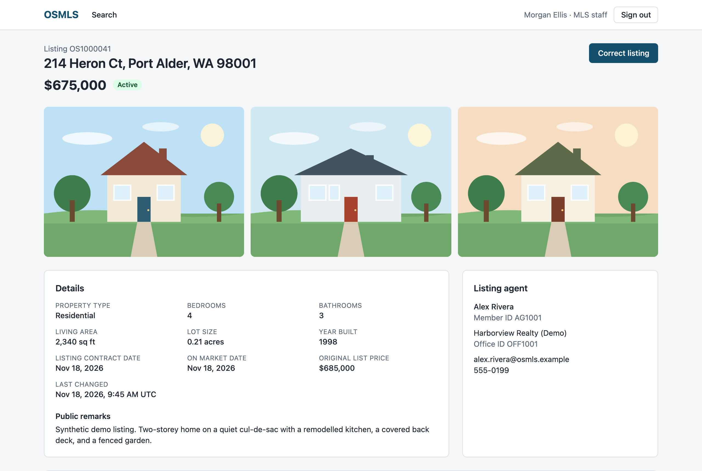

# OSMLS

An open-source MLS platform, created by Daniel P. Harris.

OSMLS is a focused core MLS: the functions people need for everyday work, built as
complete, tested workflows rather than a long list of unfinished features. It is not
an attempt to match the feature set of commercial MLS systems.

## Status

**Version 0.1, in development. Not production-ready.**

- It has not been used by a real MLS and has had no security review.
- It is **not RESO certified**. Only RESO certifies, and OSMLS has not been
  submitted. Its field names and lookup values follow the RESO Data Dictionary
  2.1, and it has a read-only RESO Web API endpoint. RESO's own certification
  tool has been run against a local instance, with the limits set out under
  "data exchange" below; a local run is not a certification.
- All people, offices, and listings in the demo are synthetic.

[CHARTER.md](CHARTER.md) records the project's purpose, decisions, scope, and what
remains.

## Screenshots

From the demo, which uses synthetic listings and illustrated placeholder photos.

**An agent searches listings**


**Map search** (added after 0.1)


**A listing, as MLS staff see it**



**Its change history, including a staff correction**


## Creator and maintainer

OSMLS is created and maintained by [Daniel P. Harris](https://danielpharris.com)
([GitHub](https://github.com/DanielPHarris)). Daniel held senior leadership roles at
Las Vegas REALTORS®, including Chief Technology Officer, Chief Innovation Officer,
and Chief Operating Officer, and served in interim CEO leadership. That experience
in technology and operations leadership shapes OSMLS's priorities: practical agent
workflows, MLS administration, interoperability between vendors, and systems that
keep an accountable record of who changed what.

OSMLS is an independent project. It is not affiliated with or endorsed by Las Vegas
REALTORS® or the Real Estate Standards Organization (RESO).

## What version 0.1 does

One workflow, end to end:

1. **An agent creates a listing.** Required fields and formats are validated. Only
   permitted status changes are allowed. Photos can be uploaded.
2. **Another agent finds it.** Search by listing number, address, city, ZIP code,
   price range, bedrooms, bathrooms, and status, then open the full listing.
3. **MLS staff inspect its history.** Every change records who made it, when, the
   field, and the old and new values. Staff can correct any listing, but must give a
   reason, and the correction is marked as such.

Rules behind it:

- A listing agent can change only their own listings, and not once a listing is
  Closed, Canceled, or Expired. After that, only a staff correction can change it.
- History is written in the same database transaction as the change it describes.
  The database refuses any attempt to edit or delete a history row.
- Photos and listings are visible only to signed-in, active members.

### Added since 0.1: map search

- **Pin a listing.** On the listing form, click the map to place a pin or drag it to
  move it. Latitude and longitude fields show the same position and can be typed
  instead. A location is optional, but it is both coordinates or neither. Changes
  are recorded in the listing's history.
- **See results on a map.** The search page shows a pin for each matching listing
  that has a location. Selecting a pin shows the address, price, and status, with a
  link to the listing. Pins can be reached and opened from the keyboard, and every
  listing on the map is also in the results table.
- **Search this area.** Limits results to the part of the map on screen, together
  with every other filter. The area is kept in the page address, so a search can be
  reloaded or shared with another member.
- **Listings with no location** appear in ordinary searches marked "Location
  unavailable". An area search leaves them out, and says how many, because they
  cannot be placed inside the area.
- **If the map cannot be loaded,** the search form, the results table, and the
  listing form all keep working, and the page says the map is unavailable.

Not included: drawing shapes or radius circles, turning an address into a location
automatically, boundary layers, and map areas that cross the 180th meridian.

#### The map service

The map is drawn with [MapLibre GL JS](https://maplibre.org/). Where the map itself
comes from is one setting, `MAP_STYLE_URL`, which takes any MapLibre-compatible
style URL.

- If it is not set, OSMLS uses [OpenFreeMap](https://openfreemap.org/)'s public
  service, which needs no account or key. **That service comes with no availability
  guarantee and may be discontinued without notice.** It is a default for demos.
  Anyone running OSMLS for real use should choose a map tile service suited to
  their needs, self-hosted or managed, and set `MAP_STYLE_URL` to it.
- The map's credit line comes from the style (for the default: OpenFreeMap,
  OpenMapTiles, and OpenStreetMap) and is always shown in full. Keep it.
- When a member views a map, their browser requests map tiles directly from the
  map service. No listing data is sent to it.
- In the demo data, the towns are invented and pins are arbitrary points. They do
  not mark real properties.

### Added since 0.1: documents and showing instructions

Both carry information that not every member should see, so each has access rules,
enforced on the server in one place ([src/lib/access.ts](src/lib/access.ts)).

**Who is who.** "Listing office" is the one office named on the listing, not the
whole brokerage. "MLS staff" is an active account that holds the staff role. A
suspended (inactive) account can do nothing, whatever its role. Anything the tables
below do not allow is refused.

**Documents.** Each document has one permission. A new document starts at the most
restrictive.

| Permission | Who can view and download |
| --- | --- |
| Listing agent only (the default) | The listing agent and MLS staff |
| Listing office only | The listing agent, agents in the listing office, and MLS staff |
| All MLS members | Any active member |

- The listing agent can add, rename, replace, and delete documents and change their
  permission, until the listing is Closed, Canceled, or Expired. MLS staff can at
  any time, as a correction with a reason.
- PDF, JPEG, and PNG only, identified by the file's content, up to 15 MB each and
  25 per listing. The limits are in
  [src/lib/rules/local.ts](src/lib/rules/local.ts).
- Files are kept in a folder nothing serves directly, under generated names. The
  only way to one is a download route that checks access on every request and
  always sends the file as a download.
- A document someone may not see is left out of what they are sent, and asking for
  it directly gets the same "not found" as a document that does not exist.
- Replacing or deleting a document takes it out of the application at once: no one
  is served it again. Its file is deleted from disk later, by the next backup run,
  and stays inside backups until they are pruned (see "backup and recovery"), so
  deleting a document does not make it unrecoverable at once. History keeps its
  name, type, size, and SHA-256 hash, but not its contents.

**Showing instructions.** Instructions, requirements, a contact, and lockbox type
and location.

| Listing status | Who can view |
| --- | --- |
| Coming Soon, Active, Active Under Contract, Pending, Hold, Withdrawn | Any active member |
| Closed, Canceled, Expired, and any other status | The listing agent, agents in the listing office, and MLS staff |

Showing details never appear in search results.

**Limits you should know about**

- **Files are not scanned for malware.** Checking that a file is a PDF or an image
  says what type it is. It does not show the file is safe to open, PDFs included.
- **Entry codes are a usage restriction, not a guarantee.** OSMLS has no field for
  lockbox combinations or gate codes, and the forms tell agents not to enter them.
  Nothing stops someone typing a code into free text or uploading a file that
  contains one.
- No earlier versions of a replaced document are kept.
- There is no record of who viewed or downloaded a document.
- Files are stored on local disk only.
- Change history, which describes documents by name, is visible to MLS staff only.
- There is no export. Any added later must use the same access rules.

### Added since 0.1: market research

Sold search, days on market, and comparables.

**Days on market are a policy, not a fact.** The RESO Data Dictionary defines both
days on market (DOM) and cumulative days on market (CDOM) only as "defined by the
MLS business rules", so figures from different MLSs are not comparable. OSMLS does
not pick one policy for everyone. It has six settings, which an MLS changes on the
**Settings** screen (see "staff permissions and market-time settings" below). A new
installation starts with the values in
[src/lib/rules/market-time.ts](src/lib/rules/market-time.ts):

| Setting | What it decides | Starting value |
| --- | --- | --- |
| Statuses that accumulate days | The one list of statuses in which a listing gains days. In every other status the count is paused. | Active, Active Under Contract |
| Relisting gap | How long a property may be off the market and still have a new listing continue the old count. | 30 days |
| Brokerage change resets the count | Whether a relisting by a different brokerage starts from zero. Brokerages are compared, not offices. | No |
| Address fallback | Whether listings may be matched by address when a parcel match is not possible. | On |
| Gap endpoint | Whether the gap ends when the new listing was entered, or when it first went on the market. | Entered |
| MLS time zone | The time zone whose calendar dates are counted. | Pacific time |

- **These are OSMLS's starting values, not a standard.** An MLS adopting OSMLS
  should set them to match its own rules.
- **Changing a setting recalculates the past.** Nothing is stored: the figures are
  worked out from each listing's status history whenever they are shown, so a new
  value changes them for old listings too. A policy cannot be applied from a date.

How the count works with the defaults:

- Days are calendar dates in the MLS time zone. A stretch on the market counts the
  difference between the date it started and the date it ended; time spent Pending,
  on Hold, or Withdrawn in between is not counted.
- CDOM adds the DOM of the earlier listings a listing continues. The most recently
  entered earlier listing of the same property is found first, and only then
  tested: it must have ended Canceled, Expired, or Withdrawn, and the new listing
  must have been entered fewer than 30 days after it ended. If it fails, the chain
  stops there. **A sale always breaks the chain.**
- The 30 days run from the date the earlier listing reached its final status. For a
  listing that went Pending and was canceled weeks later, that is the cancellation,
  not the day it stopped accumulating days.
- If a new listing is entered before the earlier one has ended, it continues the
  earlier one, and the days when both were on the market are counted in both, so
  they appear twice in CDOM. Nothing is subtracted. This is a deliberate default.
  An earlier listing that is still open is never continued.
- Two listings are the same property if their parcel number, county, and state all
  match, or, when either lacks a parcel number or county, if their street number,
  street name, city, state, and ZIP code match exactly. Unit numbers must agree
  either way. A parcel number alone never matches, because it is only unique
  within the county that issued it.

**Sold search.** Search by close date and close price, and sort by price, close
date, or days on market. Results show DOM and CDOM.

**Timeline.** Each listing shows members its status and price changes with their
dates. It names no one and says nothing about staff corrections, documents, or
showing instructions; full change history remains for MLS staff.

**Comparables.** From a listing, "Find comparables" lists other listings that are,
by default, closed within 180 days, of the same property type, within 1 mile,
within 20% of its living area, and within 1 bedroom. Each criterion can be changed.
A listing with no map location is compared within its ZIP code instead. The page
shows the median close price, price per square foot, and days on market when there
are at least three sales. **These describe those sales. They are not a valuation,**
and no adjustments are made between properties.

**Limits you should know about**

- Matching by address is fragile: "12 Oak St" and "12 Oak Street" do not match.
- Matching depends on what was typed. A wrong parcel number, county, or unit can
  link unrelated listings or miss a real relisting. Compliance staff can say
  which earlier listing a listing continues, or that it continues none (see
  "compliance flags and relisting links" below).
- Overlapping listings of one property count their shared days twice, as described
  above. Two open listings of one property should be rare; an MLS that has them
  will want its own rule, and there is no setting for it.
- Sorting by days on market works on the listing's own DOM, not CDOM.
- Comparables use distance in a straight line between map pins. A comparable with
  no pin, found by ZIP code, shows no distance and is listed after those that have
  one.

### Added since 0.1: saved searches and collections

The first of four slices of "saved work, sharing, and alerts". Printable reports
saved-search activity, and email sharing with scheduled alerts (all below) are the
other three.

- **Saved searches.** Save the current search under a name, run it again, rename
  it, update its criteria, or delete it. A saved search keeps the criteria, not the
  results.
- **Collections.** Named lists of listings. Add listings from search results or
  from a listing's page; open a collection to see them as they are today.

**Saved work does not grant access.** It is a member's private note of what to look
at, never a way to see something.

- It belongs to the member who created it. No one else can see or change it: not a
  colleague in the same office, and not MLS staff.
- Ownership is checked on the server for every read and every change. Asking for
  someone else's saved search or collection gets the same "not found" as asking
  for one that does not exist.
- Running a saved search performs an ordinary search as the member is now, and
  opening a collection reads each listing as the member may see it now. Showing
  details and documents never appear in either.
- "Only my listings" is saved as that choice, not as a member, so a saved search
  cannot be used to search as someone else.
- Nothing restricted is stored: a saved search holds criteria, and a collection
  holds which listings are in it.
- A suspended account can use none of its saved work. It is kept, and is there
  unchanged if the account is reinstated.

If the application no longer accepts something a search was saved with, that
criterion is ignored when the search is run and the page says which ones were, since
dropping a criterion usually widens the results.

Limits, set in [src/lib/rules/local.ts](src/lib/rules/local.ts): 50 saved searches
and 50 collections per member, 200 listings per collection, and names of up to 80
characters that are unique for that member.

Not included: sharing saved work with anyone, folders, notes, reordering, and MLS
staff access to members' saved work.

### Added since 0.1: printable reports

The second of four slices of "saved work, sharing, and alerts". A member can print
one listing, a collection, or the current search results, as an **agent copy** or a
**client copy**. Printing is the browser's own, including "Save as PDF"; OSMLS does
not generate or store PDFs.

- **Client copy.** The first thing OSMLS produces that is meant to leave the MLS.
  It is built on the server from one explicit list of permitted fields, in
  [src/lib/rules/client-copy.ts](src/lib/rules/client-copy.ts): listing number,
  status, type, list price, close price and date when closed, address, beds, baths,
  living area, lot size, year built, public remarks, photos, the listing agent's
  and office's names, and the details of the member who prepared it. Nothing else
  is sent to the browser. Photos are referred to by the application's photo
  address only.
- **Agent copy.** Adds days on market, original list price, county, parcel number,
  and showing details where the requesting member may see them under
  [src/lib/access.ts](src/lib/access.ts). Every page is marked as an agent copy.
- **No printout** carries change history or documents, for any member.
- A client copy includes only Active, Active Under Contract, Pending, and Closed
  listings. This, and leaving days on market and original list price off client
  copies, are OSMLS's starting defaults, set in that same file. They are not access
  rules and not a statement of any MLS's policy.
- A report holds up to 50 listings, and a single listing up to 6 photos (set in
  [src/lib/rules/local.ts](src/lib/rules/local.ts)). Status is applied before the
  limit. A report says, at the top and the bottom, what it left out and why, and
  gives a total only when one was counted: a search reads at most 100 matches, so a
  report of a larger search says it is incomplete instead of claiming a total.
- Collections print in the order listings were added; searches in the search's
  chosen order. A report of someone else's collection is "not found".

Not included: generated PDFs, comparables or CMA reports, logos or branding,
choosing which fields to print, a map in print, a record of what was printed, email,
and share links. The page footers that repeat "agent copy" on every printed page
rely on CSS page-margin boxes, which Chromium-based browsers support; other
browsers still print the label at the top of the report.

### Added since 0.1: saved-search activity

The third of four slices of "saved work, sharing, and alerts". Each saved search
shows what is new or changed since its activity was last reset: on the saved
searches list as a count, and on a page of its own. Scheduled email alerts are the
fourth slice, below; they never mark this activity as seen.

- **What counts.** A new listing, a status change, and a list price change. Nothing
  else: not remarks, photos, documents, showing details, address, beds, or baths.
- **What a member is given.** The change and when it happened. Activity is built
  from the change history, which only MLS staff may read in full, so who made a
  change, whether staff made it, and the reason given are never sent.
- **Which listings.** Those that match the search as the member would run it now
  and have such a change. A second group, "may no longer match", holds listings
  that do not match now and would with their status and list price as they were.
- **A limit of that second group.** Only status and list price are taken from
  history. Every other criterion is checked against the listing as it is today. A
  listing whose bedrooms, address, or map location also changed can appear there
  without ever having matched, or be missing although it did; and a listing that
  started or stopped matching only because another field changed is not reported.
- **"Since".** Saving a search starts it with no activity. Changing its criteria
  starts it again. Renaming does not. Saved searches made before this feature
  start from when it was installed.
- **Seen only when you say so.** Only the button on the activity page marks
  activity as seen. Viewing, reloading, counting, and running the search change
  nothing. The button clears everything up to when its page was loaded, and
  nothing that arrived after. When the page left anything out, the button says so.
- **Limits**, set in [src/lib/rules/local.ts](src/lib/rules/local.ts): 100 listings
  a page, most recently changed first, and each listing's 10 most recent changes.
  The page says when more listings have activity, without claiming a count, and how
  many earlier changes each listing leaves out.
- Activity belongs to the saved search's owner. Anyone else gets "not found", for
  reading it and for marking it seen.

How the checkpoint works, and what it costs: a saved search remembers a history
sequence number. A database trigger hands those numbers out in the order
transactions commit, by making each transaction that records a listing change take
one lock until it ends. That is what makes "everything up to number N" safe: a
change committed late cannot land behind a checkpoint and be skipped. The cost is
that changes to listings are committed one at a time across the whole MLS. Photo
and document files are written before that lock is taken. How much this limits a
busy MLS has not been measured.

Not included: activity for collections, a count in the
page header, live updates, dismissing single changes, and rebuilding criteria other
than status and list price from history.

### Added since 0.1: sharing with clients and scheduled email alerts

The fourth of four slices of "saved work, sharing, and alerts". A member can give a
client a link to one listing or to one of their collections, and can have activity
on a saved search emailed to themself on a schedule.

**Links for clients**

- **No account needed.** The link is the permission: anyone holding it can open the
  page until it expires or is revoked. Treat a link like the listing sheet it
  replaces.
- **Client copy only.** The page is built by the same function, from the same list
  of permitted fields and statuses, as a printed client copy
  ([src/lib/rules/client-copy.ts](src/lib/rules/client-copy.ts)). Tests read the
  whole response, for a listing and for a collection, and find nothing else in it.
- **Current contents.** A page shows listings as they are when it is opened. A
  collection link shows what is in the collection then, so **a listing added later
  becomes visible to anyone holding the link**; the collection page says so and
  says when a collection is shared. A listing outside the client statuses is left
  off and counted, and a page is cut off at 50 listings and says so.
- **Expiry.** 7, 30 (the default) or 90 days. There are no permanent links and no
  extensions.
- **Shown once.** Only a hash of a link is stored, so a link is shown when it is
  made (and in the email, if emailed) and cannot be read back afterwards.
- **Ending access.** A link stops working when its owner revokes it, when it
  expires, while its owner's account is suspended, and when a shared collection is
  deleted. Each answers exactly like a link that never existed, for the page and
  for its photos.
- **Photos.** Served under the link's own address, only while the link works and
  only the photos its page shows. The members-only photo address is unchanged.
- **Not stored or passed on.** Pages and photos are sent with `no-store`, are
  marked not to be indexed, send no referrer, and load nothing from other sites.
  Who opens a link is not recorded.
- **Limits.** 50 working links and 50 emailed links a day per member.
- **What revoking cannot do.** It cannot recall a page or a photo someone already
  saved.

**Email**

- **The operator's mail server.** Set `SMTP_URL` and `MAIL_FROM`. With either
  unset, email is off: the screens say so, links can still be made and copied, and
  alerts cannot be switched on.
- **The demo delivers nothing.** `docker compose up` starts a
  [Mailpit](https://mailpit.axllent.org/) mail catcher; read what was "sent" at
  http://localhost:8025.
- **Plain text, and no listing data.** A sharing email has the member's name and
  office, an optional short note, the link, when it expires, and a link to stop
  further email. Replies go to the member.
- **Not handled:** bounces, delivery reports, and sender reputation (SPF, DKIM).

**A recipient's address**

- **Kept only while its link works.** It is deleted when the link is revoked, and
  by the scheduled command once the link has expired.
- **Stop link.** Every sharing email has one, and it needs no account. Opening it
  changes nothing; its button deletes the address from every link and blocks
  further email to it from this installation. Links already sent keep working.
- **How the block is kept.** As a keyed hash of the address, not the address. A
  member who enters a blocked address is told it cannot be emailed.
- **Records.** A link's record, with the keyed hash of its recipient, is deleted 30
  days after the link ended. After that its stop link no longer works. Deleting a
  shared collection ends its links and deletes their addresses but keeps these
  records for that time, so the emails still count towards the daily limit and
  their stop links still work.

**Scheduled alerts**

- **To the member only.** A saved search's owner can have its activity emailed to
  their account address, daily or weekly. It is off until switched on. Nothing is
  emailed to clients on a schedule. A suspended member is sent nothing; that is
  checked again for each alert as it is sent, not once for the run.
- **What the email says.** How many listings have activity, and a link to the
  activity page, which requires sign-in. No listing data.
- **Run by a command.** `pnpm alerts:send` sends what is due and deletes expired
  addresses and old link records. The operator schedules it; the Compose demo runs
  it hourly. Only one run proceeds at a time.
- **A separate checkpoint.** Email has its own checkpoint. Sending never marks
  activity as seen in the application, and marking as seen never holds back an
  email.
- **Nothing is skipped.** The email checkpoint moves only after the mail server
  accepts the message, to a boundary read in the same snapshot as the activity.
- **Not exactly once.** Email cannot promise that. What happens instead:

  | Outcome | What happens |
  | --- | --- |
  | The server refuses, or cannot be reached | Not delivered. Tried again on the next run. After 5 in a row the alert pauses. |
  | No answer after the message was handed over, or the server accepted and recording that failed | It may or may not have been delivered. Tried again on the next run, up to 3 sends in all, then the alert pauses. |

  A paused alert says so on the saved searches page, and after unknown outcomes
  says the email may have arrived up to 3 times or not at all. Pausing skips
  nothing: resuming sends what is pending. Repeats carry the same Message-ID, which
  some mail systems use to hide duplicates; that is not relied on.
- **When the checkpoint starts again.** Switching alerts on, or on again after
  being off, starts from that moment. Changing the criteria resets it, with the
  schedule and any pause. Renaming and changing the frequency keep it, and so does
  a suspension: once reinstated, the member is sent what accumulated.
- **Changes during a send.** A send that finishes after the member changed the
  criteria or switched the alert off does not write over what they set.

Not included: client accounts, scheduled email to clients, sharing a saved search,
HTML or branded email, open and click tracking, bounce handling, staff screens for
members' links, and text messages. How an unknown outcome is recognised depends on
the mail library's error codes; anything not recognised as a refusal is treated as
unknown.

### Added since 0.1: member administration and access suspension

The first of three slices of "administration". MLS staff can add a member, change
a member's details and role, and suspend or reinstate a member's access, at
**Members** in the page header. Offices and brokerages are the second slice, and
staff permissions the third, both below.

- **Who may.** Staff who hold "Manage members", for agents; staff accounts take
  "Manage staff" (see staff permissions below). For anyone else these pages and
  actions answer "not found".
- **Adding a member.** Name, email, member ID, role, phone, and for an agent an
  office. The member record and the sign-in identity are made together or not at
  all. There is still no public sign-up.
- **Passwords.** Staff never choose or see one. A new member is emailed a link to
  set their own: it works once, for 24 hours, and only a hash of it is stored.
  Staff can have a new link sent; it is always a new link and ends the earlier
  one. Using a link ends the member's other sessions. With email off, the link is
  shown once to the staff member to pass on. There is no self-service "forgot
  password".
- **Changing an email** changes the sign-in address with it, and ends any password
  link already sent, since that went to the old address. Making a link and changing
  an email are taken one at a time for each member, so a link is always for the
  address the member has when it is made, and only the newest link works.
- **Role and office.** Making a member an agent needs an office; making one MLS
  staff removes it. Moving an agent between offices is described below. A listing
  keeps the office recorded on it whatever happens to its agent.
- **Suspension.** Needs a reason. It denies access through every session the
  member has, at once; it does not delete those sessions, so reinstating restores
  access without a new sign-in. A suspended member can still sign in and is then
  refused everything. Their client links and photos stop working and their email
  alerts stop. Nothing of theirs is deleted, and reinstating restores it all.
- **Guards.** A staff member cannot suspend themself or change their own role.
  Every change to anyone's status or role is taken one at a time across the MLS,
  and the acting member's own authority is checked again inside that turn, so two
  staff who suspend each other at the same moment cannot both succeed.
- **The record.** Every administrative change is recorded with who made it, the
  old and new value, when, and the reason where one is required. Staff can read it
  on the member's page. Passwords and password links are never written to it.
- **No deletion.** A member is suspended, never removed, because history refers to
  them.


### Added since 0.1: offices and brokerages

The second of three slices of "administration". MLS staff can add an office,
change its details, group offices into a brokerage, deactivate and reactivate an
office, and move an agent from one office to another, at **Offices** in the page
header and on each member's page.

- **Who may.** Staff who hold "Manage offices".
- **A brokerage is a main office and its branches**, one level deep. A branch's
  main office must itself be a main office, an office with branches cannot become
  a branch, and an office cannot be its own main office.
- **Grouping changes no one's access.** Office-only documents and showing details
  stay with the one office named on a listing, not its brokerage.
- **An active agent is always in an active office.** An office with active agents
  cannot be deactivated; staff move or suspend them first. An inactive office
  cannot be given an agent by any route: adding a member, making MLS staff an
  agent, moving an agent, or reinstating one. A suspended agent can be moved, so
  that they can then be reinstated.
- **An active branch always has an active main office.** A main office with active
  branches cannot be deactivated, and an active branch cannot be added under,
  moved under, or reactivated under an inactive main office.
- **Moving an agent** needs a reason. Their listings keep the office recorded on
  them and they remain the listing agent. What the old office's membership let
  them see of colleagues' listings goes on their next request, including in a
  session already open, and the new office's comes. Saved work, client links, and
  alerts are untouched.
- **Reasons and the record.** Deactivating, reactivating, and moving each need a
  reason. Every change to an office is recorded with who, what, and when, and is
  shown on the office's page; a move is recorded on the member.
- **One at a time.** Every change to an office's status or brokerage, and every
  move and reinstatement, takes the same MLS-wide turn as status and role changes,
  so each rule is checked against a state nothing else is changing. Tests race a
  move, a reinstatement, and a regrouping against a deactivation.
- **No deletion.** Listings and history refer to offices.

Not included: brokerage-wide access, broker or office-manager roles, moving
listings between offices, bulk moves, and licence or membership data.

### Added since 0.1: staff permissions and market-time settings

The third of three slices of "administration".

**Staff permissions.** Administration is divided into capabilities, each held
by individual staff accounts:

| Capability | Allows |
| --- | --- |
| Manage members | Add, edit, suspend, reinstate and move agents; change their email; send them password links |
| Manage offices | Add, edit, deactivate and reactivate offices; group them into brokerages |
| Manage settings | Change the market-time settings |
| Manage compliance | See and close flags, and say which earlier listing a listing continues (added with compliance flags, below) |
| Manage data access | Add and revoke the outside systems that may read the data exchange feed (added with data exchange, below) |
| Import listings | Load new listings from a file on behalf of agents (added with imports, below) |
| Manage staff | Add staff accounts, change a role to or from staff, grant and revoke capabilities, and do any member action to a staff account |

- **They divide administration and nothing else.** Every active staff account can
  still correct any listing and see all documents and showing instructions, as
  before.
- **Managing members is not managing staff.** Someone who holds only "Manage
  members" cannot add a staff account, change a role to or from staff, or edit,
  suspend, change the email of, or send a password link to a staff account. So
  they cannot take one over.
- **Granting.** Only a holder of "Manage staff" grants or revokes, on the staff
  member's page, with a reason, and it is written to that member's change record.
  A new staff account starts with none. Making staff an agent takes theirs away.
- **Only on an active staff account.** A capability recorded on an agent or on a
  suspended account allows nothing.
- **Decided inside the operation.** Who is acting and what they are acting on
  are both read again inside the protected step, not taken from what the request
  saw. An agent who became staff while an email change for them was waiting is
  treated as staff; a capability revoked while an action was waiting refuses it.
  A revocation applies to a session already open at its next action.
- **Someone can always manage staff.** The last active account holding "Manage
  staff" cannot give it up, be suspended, or be made an agent, including when two
  such changes are made at the same moment. An administrator may give up their
  own while another remains.
- **Upgrading.** Every existing staff account, active or suspended, is given the
  four capabilities above other than "Manage compliance", so nothing changes
  until someone narrows it.

**Market-time settings.** Staff who hold "Manage settings" change the six settings
at **Settings** in the page header. No redeployment or restart is involved.

- **Limits.** At least one status must gain days, chosen from the standard
  statuses other than Closed, Canceled, Expired and Withdrawn. The relisting gap
  is a whole number from 0 to 365. The time zone is an IANA name. These limits are
  OSMLS's choices.
- **The record.** Each save needs a reason and is kept as a new version with who
  made it, when, and the old and new value of each setting changed. Earlier
  versions are never altered. The screen shows them all.
- **Two people editing.** A save made from a version that is no longer in force is
  refused, and the current values are shown.
- **It recalculates the past.** A saved change applies to every listing, past and
  present, from the next page or run. Figures are not stored, so there is one
  policy at a time: no effective dates, and no record of what a figure used to be.
  The screen says this, and asks for confirmation, before saving.
- **One version per operation.** A page, an action, and the scheduled alert run
  each use one version of the settings from start to finish, whatever is saved
  meanwhile. Nothing in the application reads the starting values in code.
- **Time zone.** It also decides calendar dates elsewhere, such as the date a
  listing went on the market and the dates on a member timeline. Dates and times
  already stored are never rewritten; a new zone applies to dates worked out from
  stored times, and to dates stored from then on.
- **Alerts.** A settings change alone sends no email.

Not included: custom roles or groups, staff limited to particular offices,
permissions for agents or brokers, settings that apply from a date or differ by
office, and settings for comparables.

### Added since 0.1: compliance flags and relisting links

The charter's "basic compliance workflow": a member flags a problem with a
listing, and MLS staff track it to a close. It is a record of reports and what
was done about them. It does not find problems by itself, and it is not legal
compliance.

**Flags.** On any listing, under **Flags**, any active member can report a
problem: a category from a fixed list (incorrect information, photos, remarks,
status not updated, duplicate listing, market time or relisting link, other) and
a description.

- **A flag changes nothing.** It does not change, hide, or penalise the listing.
  If something needs correcting, staff correct it the ordinary way, with its own
  reason and history entry.
- **Who handles them.** Staff who hold "Manage compliance" see every flag at
  **Flags** in the page header, narrowed by state, category, and listing office,
  and close each as Resolved or Dismissed with a note. A closed flag is final; a
  new problem is a new flag.
- **Who sees what.**

  | | Compliance staff | The member who raised it | Listing agent and listing office | Anyone else |
  | --- | --- | --- | --- | --- |
  | That the flag exists, its category and state | Yes | Their own | On their listing | No |
  | Description and closing note | Yes | Yes | Yes | No |
  | Who raised it | Yes | n/a | Never | No |
  | Who closed it | Yes | No | No | No |

- **Who raised it stays with compliance staff.** What the listing side is given
  is built without the reporter's name, member ID, email, or office; it is not a
  full record with parts hidden. But the description and the closing note are
  free text that the listing side reads, and nothing is redacted, so a flag is
  only as anonymous as what was typed. The form says so.
- **Limits.** One open flag per member, per listing, per category, and 20 flags
  per member per calendar day in the MLS time zone. Both hold when flags are sent
  at the same moment.
- **Not on reports.** Flags never appear on agent copies, client copies, or pages
  shared with clients.
- **No email.** Flags are seen in the application.
- **Upgrading.** "Manage compliance" is given to every account that holds "Manage
  staff".

**Relisting links.** Cumulative days on market follows the earlier listing of the
same property, found by parcel number and address. On a listing, compliance staff
can set one of three things, with a reason:

| Setting | Meaning |
| --- | --- |
| Automatic (the default) | The earlier listing is found by matching. |
| None | This listing continues no earlier listing. |
| A named listing | That listing, given by its listing number, is the earlier one. |

- **Naming a listing settles one question only:** that it is the same property.
  It is not checked against parcel, address, or the address-fallback setting, so
  it can repair a match that was missed.
- **Everything else still applies.** The relisting gap, where the gap ends, the
  brokerage rule, and how the earlier listing ended still decide whether the
  count continues. A named listing that fails them stays on record, and the count
  starts fresh.
- **Never past a sale.** If the property was sold between the two listings, the
  link is refused; if such a sale is entered later, the link stops being followed.
  The sale is recognised by matching, so if it is in truth a different property
  that was matched by mistake, correct its parcel number or address first.
- **Only an earlier listing** can be named, so a listing cannot continue itself
  and chains cannot loop.
- **It recalculates the past**, like a settings change: figures change wherever
  they are shown, from the next page or run.
- **The record.** Each change is in the listing's change history as a staff
  correction with its reason, which staff can read. Members see the resulting
  figures and which listings they include, not that staff set them.

Not included: finding problems automatically, fair-housing checks on remarks,
redacting free text, fines, deadlines, appeals, email about flags, flags on
members or offices, bulk actions, and rules that two listings are never the same
property.

### Added since 0.1: data exchange, a read-only RESO Web API feed

The first of three slices of "data exchange". An outside system holding a bearer
token reads listings, agents, offices and photo records in the RESO Web API's
OData form, at `/api/reso`. A second, narrower feed and file export are the second
slice, and importing new listings the third; both are described after this one.

**A distribution policy.** The feed is a new way for listing data to leave OSMLS.
It is wider than a client copy: it carries listings in every status, parcel and
coordinates, and agent and office records. It is narrower than what a member
sees: it never carries documents, showing instructions, or lock box details.
What it carries is for the MLS to decide; these are OSMLS's starting choices.

**The allowlist.** [src/lib/rules/data-exchange.ts](src/lib/rules/data-exchange.ts)
lists every resource and field the feed may carry, by hand. It is the only source
for the feed's metadata, its Field and Lookup resources, its responses, and what
a query may name. A column added to the database is not served until it is added
there. **Data access** in the page header shows the list to staff.

| Resource | Carries |
| --- | --- |
| Property | Every listing: identifiers, status, type, prices, dates, address, county, parcel, coordinates, rooms and size, public remarks, listing agent and office keys, timestamps, days on market and cumulative days on market |
| Member | Agents only: keys, member ID, name, status, office. No email or phone, and no MLS staff accounts |
| Office | Keys, office ID, name, main office, status, phone, city, state |
| Media | Photos of listings only: keys, order, description, type, and an address to fetch the photo from |
| Field, Lookup | The served fields, and the values of the fields that hold one of a list |

Never in the feed: showing instructions and contacts, lock box fields, documents
and their records, change history, flags, relisting links, saved work, shares,
members' email and phone, roles and capabilities, sign-in identities, and file
storage details. Naming something that is not served, in any query option or in
the address, is an error, never a silent omission.

**Reading it.**

- `$select`, `$filter` (comparisons joined by `and`, `or`, `not`), `$orderby`,
  `$top`, `$skip`, `$count`, one record by key, and `$expand=Media` on Property.
- `$top` is the most records wanted. A page holds at most 200; only a page the
  server cut short carries `@odata.nextLink`. `Prefer: odata.maxpagesize` asks
  for smaller pages.
- A page link carries the place of the last record read, not a count to skip, so
  records added or changed while a consumer is reading do not make it repeat or
  miss one.
- Times are served to the millisecond, and compared, sorted and paged at the
  millisecond, so a filter on a served time finds its record. Stored times keep
  their full precision.
- `contains`, `startswith` and `endswith` are not supported. RESO's tool treats
  them as optional.

**Lookups.** StandardStatus, PropertyType, MemberStatus, OfficeStatus, and the
feed's one media category and resource name are fixed lists and are given as the
standard values they are. City, county, state and media type are whatever served
records hold: the Lookup resource lists the values found in served records only.
A found state is called a standard value only if it is a real postal
abbreviation; cities, counties and media types are given as local values, with no
claim that they are standard.

**Who may read.**

- Staff who hold "Manage data access" add a named data consumer and are shown its
  bearer token once. Only a hash is stored. A token can carry an expiry and can be
  revoked, and is then refused from the next request.
- A member's sign-in opens nothing in the feed, and a token opens nothing else.
- Photos are fetched from the address in `MediaURL` with the same token. That
  route serves photos only.
- Every request is logged with the consumer, what was asked, and how many records
  were returned. A consumer is limited to 1,200 requests a minute.

**What polling does and does not keep current.** Complete synchronization is not
promised.

- A consumer that polls on `ModificationTimestamp` receives every record whose own
  stored fields changed. Listings and offices are never deleted.
- **Days on market** and cumulative days on market are worked out when a response
  is made. They change with time, with a market-time settings change, and with a
  relisting-link correction, none of which moves a listing's timestamp. A consumer
  that keeps them reads its listings again to refresh them.
- Filtering or sorting on those two figures works them out for every listing in
  the feed first. That is correct and it is not cheap; on a large MLS it would
  need its own design.
- **Photos.** Adding or removing a photo moves its listing's timestamp, so a poll
  reports the listing, and reading it with `$expand=Media` gives its photos as
  they now are. A removed photo's own record is simply gone.
- **Members.** The feed carries agents only. An agent made MLS staff stays in the
  database and leaves the feed, and nothing reports that. A consumer reconciles by
  reading the current member keys and treating those it no longer finds as gone.
- RESO's EntityEvent change feed is not built.

**RESO's certification tool.** RESO publishes the tool it certifies with
(`@reso-standards/reso-certification`). It was run from outside this repository
against a local instance on 2026-11-20, version 0.13.1. None of RESO's files are
in this repository.

| Run | Web API Core 2.1.0 | Data Dictionary 2.1 |
| --- | --- | --- |
| First, on the first working feed | 67 passed, 11 failed, 87 skipped | Metadata validation failed with 12 issues; records not reached |
| Final, on commit `6b92774` | 153 passed, 0 failed, 173 skipped; 18 optional scenarios not supported | 6 steps passed, 1 skipped; 756 records replicated and validated in strict mode; 49 warnings |

The final run tested the feed's code as it stood at commit `6b92774`. The only
change after it in the pull request that added the feed is this paragraph and the
table row above.

What the first run found, and what was done:

- A next-page link was returned when the records asked for had all been given (3
  failures). Fixed.
- A filter on a served time did not find its own record, because of the
  millisecond difference above (6 failures). Fixed.
- Days on market could not be filtered on (2 failures). They now can.
- `LivingArea` was declared as a whole number and is a decimal in the Data
  Dictionary. Fixed.
- Eleven fields that hold one of a list of values did not say so, and there was no
  Lookup resource. Built.

What the final run does **not** show:

- **It is not a certification**, and its report says it is not eligible for one.
- **Variations were not checked.** That step sends the feed's field and value names
  to RESO's service and needs RESO credentials. It was skipped, so whether any
  local name is too close to a standard one is unknown. A run that skips it cannot
  be certified.
- **HTTPS was not tested.** The specification requires HTTPS with TLS 1.2 or later.
  OSMLS serves plain HTTP and expects a deployment to put TLS in front of it; there
  is no hosted instance.
- **The data was synthetic and small**: the seeded demo listings, with placeholder
  photos added by `pnpm feed:fixtures`. Certification samples up to 100,000 records
  per resource.
- **Skipped scenarios are not passes.** The tool records no reason for a skip. By
  their names, the 173 are scenarios for a data type or expansion a resource does
  not have (a decimal filter on Member, for example), and for forms the feed does
  not use: OData enumeration types and multi-valued lookups. The feed has no
  multi-valued lookup at all, so those are untested, not passed.
- **The 49 warnings** are suggested maximum lengths and precisions that the
  metadata does not declare.
- The first run's Data Dictionary step was made with a 1,000-record limit and
  without strict mode, to survey everything at once; the final run used neither.

Not included in this slice: writing through the API, EntityEvent, feeds with differing field
sets, file export, imports, webhooks, and a hosted instance.

### Added since 0.1: feeds and file export

The second of three slices of "data exchange": a second feed, one feed for each
data consumer, and exporting search results to a file.

**Feeds.** A feed is what one kind of data consumer may read. Each is written out
by hand in [src/lib/rules/data-exchange.ts](src/lib/rules/data-exchange.ts), beside
the allowlist, and can only narrow it: it names fields that are on the allowlist,
may add a condition on which records it carries, and may give less than a stored
value. A test fails if a feed names anything that is not on the allowlist.

| | Full | Public display |
| --- | --- | --- |
| Listings | Every status | Active, Active Under Contract, Pending, Closed |
| Property | Everything on the allowlist | Keys, listing number, status, type, list price, sale price and date, address, city, state, ZIP code, bedrooms, bathrooms, living area, lot size, year built, public remarks, last change |
| Left off Property | Nothing | Parcel, county, coordinates, original list price, days on market, street parts, contract and on-market dates, other timestamps |
| Member | Agents, with member ID and status | Agents who have a listing in this feed: key, name, office |
| Office | With office ID, status, phone, city, state | Offices that have a listing in this feed: key and name |
| Media | Photos of any listing | Photos of listings in this feed |

- **"Public display" is what the narrower feed is meant for.** It is still read only
  with a token, and being in it does not by itself mean a consumer may publish a
  listing: that is between the MLS and the consumer.
- **Everything follows the feed.** A consumer's metadata, Field and Lookup
  resources, responses, query options, expansions, reads by key, and photos all
  answer for its own feed. A field or record outside it does not exist for that
  consumer. Lookup values found in data come only from records in that feed.
- **Sale details only for sales.** In the public display feed, a sale price and date
  are given only for a Closed listing, as on a client copy. A filter or a sort sees
  what a response would give, so a figure that is not served cannot be found by
  asking about it.
- **Leaving a feed.** A listing that moves to a status its feed does not carry stays
  in the database and leaves that feed, taking its photos with it, and its agent and
  office too if it was their only one there. Polling cannot report that. A consumer
  reconciles by reading current keys. A listing entering the feed is a change to it,
  so a poll reports it.
- **One feed for each consumer.** Staff choose the feed when adding a data consumer;
  nothing is chosen for them. It is not changed afterwards: to change it, revoke the
  consumer and add another, so a token never changes what it can read. Each request
  is logged with the feed that answered. On upgrade, existing consumers are on the
  full feed, which is what they already read.

**File export.** From a search, a member exports the listings found as a CSV file:
a header row, then one row for each listing, and nothing else.

| Kind | Columns, in this order |
| --- | --- |
| Client export | ListingId, StandardStatus, PropertyType, ListPrice, ClosePrice, CloseDate, UnparsedAddress, City, StateOrProvince, PostalCode, BedroomsTotal, BathroomsTotalInteger, LivingArea, LotSizeAcres, YearBuilt, PublicRemarks, ListAgentFullName, ListOfficeName |
| Agent export | The client export's columns, then OriginalListPrice, CountyOrParish, ParcelNumber, DaysOnMarket, CumulativeDaysOnMarket |

- **The client export is a client copy as a file**: the same rule builds it, so it
  holds the four client-copy statuses, and a sale price and date only for a sale.
- **Never in a file**, of either kind: showing instructions, lock box details,
  documents, history, flags, keys, and photo addresses. That is stricter than a
  printed agent copy, which gives showing details to members allowed to see them: a
  file travels further than a page.
- **Which listings.** A search reads at most 100 listings, in its order, and says
  whether there were more; it does not count them, and neither does the export. The
  file is made from those listings and no others. For a client export, listings in
  other statuses are then left out, so it can hold fewer than 100 while more
  eligible listings lie beyond the first 100.
- **What is disclosed.** Before the download, the export page states how many
  listings the file holds, how many were left out of a client export for their
  status, and, when the search was cut off, that the rest were not considered and
  that their number is not known. The file's name gives its kind, the number of
  listings, and the date.
- **Who.** Any active member. Each download is recorded with who, when, which kind,
  the search, and those figures. Looking at the export page records nothing.
- **Safety.** UTF-8. Text a spreadsheet would run as a formula is given a leading
  apostrophe so that it is shown and not run.

**RESO's certification tool, on each feed.** Run locally on 2026-11-20, version
0.13.1, on the code at commit `3cb4a58`, with the same limits as before: not a
certification, variations not checked, plain HTTP, and small synthetic data.

| Feed | Web API Core 2.1.0 | Data Dictionary 2.1, strict |
| --- | --- | --- |
| Full | 153 passed, 0 failed, 173 skipped; 18 optional scenarios not supported | 6 steps passed, 1 skipped; 756 records; 49 warnings |
| Public display | 147 passed, 0 failed, 179 skipped; 18 optional scenarios not supported | 6 steps passed, 1 skipped; 570 records; 32 warnings |

The six scenarios the public display feed skips and the full feed passes are the
lookup tests on Member and Office. In that feed neither resource has a field that
holds one of a list of values, so there is nothing for those tests to run on: they
are tests that do not apply, not failures and not passes. A feed's fields are a
disclosure decision and are not widened to make a test run.

Not included: feeds defined by staff, a choice of fields for one consumer, exports
of collections or single listings, other file formats, scheduled or emailed exports,
and an exact count of a search that was cut off.

### Added since 0.1: importing new listings

The third of three slices of "data exchange". Staff who hold "Import listings"
load new listings from a CSV file, at **Imports** in the page header.

**What it cannot do.** OSMLS can support evaluation and new listing entry, but
this importer cannot migrate an existing MLS's historical records. It cannot bring
in closed or ended listings, past status or price changes, or earlier dates, and it
never changes a listing that already exists. Migrating a real MLS's history is
deferred; it would need rules written against that MLS's own data.

- **Each imported listing is an ordinary new listing.** It is checked by the entry
  form's own validation, starts as Coming Soon or Active, is dated when the import
  is committed, and gets the ordinary first history entry. There is one place a
  listing is created, used by the entry form and by an import alike.
- **The file.** CSV, UTF-8, a header row, up to 500 rows. Each column is named
  exactly as the Data Dictionary field it fills: the fields of the entry form, plus
  `ListAgentMlsId` (the listing agent's member ID) and `SourceListingId` (the
  listing's identifier where it came from). There is no mapping screen. A column
  that is not on the list, a column given twice, or a required column missing
  refuses the whole file, so nothing is silently ignored. Photos, documents and
  listing numbers are not imported.
- **The listing agent.** Staff import on behalf of agents. Each row names its
  agent, who must be an active agent in an active office. The listing is that
  agent's, and its history records the staff member who imported it, the import,
  and the row.
- **Preview, then commit.** Uploading creates nothing. Staff see what each row
  would do: be created, be refused and why (every problem, not only the first), or
  be left out as a possible duplicate. A file with refused rows can still be
  committed.
- **A commit creates exactly the rows the preview accepted, or nothing.** Every row
  is judged again when the import is committed, inside one transaction. If a row
  that was going to be created no longer passes (its agent was suspended, say),
  nothing is created and the preview is brought up to date. A row the preview did
  not accept is never created, even if it would pass by then. A preview is
  committed once.
- **Duplicates.**

  | Case | What happens |
  | --- | --- |
  | The same source identifier twice in one file | Both rows refused |
  | A source identifier already imported from the same source | Refused, so a file loaded twice creates nothing the second time |
  | Two rows of one file for the same property | Both left out |
  | The same property as a listing that has not ended | Left out |

  The source's name is compared without regard to capitals or spacing. "The same
  property" is the parcel and address matching used for days on market, with its
  limits: a property typed differently is not recognised.
- **Imports and hand entry take turns.** Creating a listing first takes a lock on
  the property it is for, whether from the form or from an import, so a listing
  entered by hand cannot arrive between an import's check and its write. Nothing
  else about hand entry changes: an agent can still enter another listing for a
  property that has one.
- **What is kept.** The record of an import is permanent: who, when, the source,
  the file's name and hash, each row's outcome, and the listing each created. What
  the rows held is not kept once the import is committed. A preview that is not
  committed can no longer be opened or committed after 24 hours; what it held is
  deleted by the next run of the scheduled command (`pnpm alerts:send`), so it can
  remain stored, unreachable, until that runs.
- **Alerts.** Imported listings are new listings, so they appear in saved-search
  activity and alerts like any other.

Not included: updating existing listings; migrating history, closed listings or
earlier dates; importing photos, documents, members or offices; writing through the
API; scheduled imports; a column-mapping screen; and Excel files.

### Not yet built

Client accounts and scheduled email to clients, brokerage-wide access,
self-service password reset, migrating an existing MLS's historical records,
fair-housing checks on remarks, and production operations (monitoring, backups,
recovery). See the charter for the planned order.

## Try it

You need [Docker](https://docs.docker.com/get-docker/).

```bash
docker compose up --build
```

Open http://localhost:3000. If port 3000 is taken, use another:
`OSMLS_PORT=3300 docker compose up --build`. The database is published on port 5433;
change that with `OSMLS_DB_PORT` (and match it in `.env` if you develop locally).
Email the demo "sends" is caught, not delivered: read it at http://localhost:8025
(`OSMLS_MAIL_PORT` and `OSMLS_SMTP_PORT` move the mail catcher's ports).

Sign in with a demo account. The password for all of them is the `DEMO_PASSWORD`
value in [.env.example](.env.example).

| Account | Role |
| --- | --- |
| `alex.rivera@osmls.example` | Agent, Harborview Realty (Demo) |
| `sam.whitfield@osmls.example` | Agent, Summit Line Properties (Demo) |
| `jordan.okafor@osmls.example` | Agent, Harborview Realty (Demo), the same office as Alex |
| `morgan.ellis@osmls.example` | MLS staff, holding every capability |
| `riley.chen@osmls.example` | Suspended agent: can sign in, but is refused everything |

The secrets in `docker-compose.yml` and `.env.example` are for local demos only.

### Walkthrough

1. Sign in as **Alex Rivera**. Choose **New listing**, fill it in, and create it.
   Then choose **Edit listing**, upload a photo, and change the price. Note the
   listing number.
2. Sign out and sign in as **Sam Whitfield**. Search for the listing number and open
   the listing. Sam can read it but cannot edit it or see its history.
3. Sign out and sign in as **Morgan Ellis**. Open the same listing: the change
   history at the bottom shows who entered it, the price change with old and new
   values, and the photo. Choose **Correct listing**, change a field, and try to
   save without a reason.

The search opens showing Active and Coming Soon listings. Clear every status box to
search every status.

To try market research: search for "Comparable Ct" with Closed ticked to see recent
sales, open "1 Comparable Ct" and choose **Find comparables**. Listings on
"Relist Rd" show how the cumulative count carries across a relisting, and when it
does not.

## Develop

You need Node.js 22 or later, [pnpm](https://pnpm.io/), and Docker.

```bash
cp .env.example .env
pnpm install
docker compose up -d db mail   # PostgreSQL on localhost:5433, mail catcher on 1025 (read it at :8025)
pnpm db:migrate
pnpm db:seed
pnpm dev
```

### Tests

```bash
pnpm test                                # rules, validation, and database behaviour
pnpm exec playwright install chromium    # once, to download the test browser
pnpm test:e2e                            # the workflow, map search, access control, market research, saved work, sharing, administration, staff permissions, compliance flags, the data exchange feeds, file export, and imports in a real browser
pnpm lint && pnpm typecheck
```

Every pull request, and every push to `main`, runs these same commands plus a
production build on GitHub
([.github/workflows/checks.yml](.github/workflows/checks.yml)), in Chromium on
Linux.

Tests use their own database (`TEST_DATABASE_URL`), which is deleted, re-created,
and seeded on the same PostgreSQL server at the start of every run. They never write to the development or
demo database. The browser tests build the application and start their own
production server on port 3210, and use a blank local map style, so they do not
depend on an outside map service. They run against the production build because
the development server closes idle connections after five seconds and cannot be
told otherwise, which is the likely cause of requests that failed at random. The sharing tests
send real email to the mail catcher (`docker compose up -d mail`) and read it back. The default map
service was checked by hand in a production build, at desktop and phone widths.
The staff permissions test changes the market-time settings that other tests'
figures depend on, so it runs after the rest and puts them back. The compliance
test changes one of those figures, so it runs last and does the same.

## How it is built

- **TypeScript**, one **Next.js** application, **PostgreSQL**. No hosted services
  are required to run it.
- Schema changes are SQL migrations in [drizzle/](drizzle/), generated from
  [src/db/schema.ts](src/db/schema.ts).
- Listing logic, permissions, and history live in
  [src/lib/listings.ts](src/lib/listings.ts).
- Operating rules an MLS would want to change are kept apart from the rest:
  permitted status changes in [src/lib/rules/status.ts](src/lib/rules/status.ts),
  local formats, limits, and where maps open in
  [src/lib/rules/local.ts](src/lib/rules/local.ts).
- A listing's location is two plain numeric columns, `Latitude` and `Longitude`.
  PostGIS is not used.

### Data model

Tables and columns are named after RESO Data Dictionary 2.1 resources and fields:
`Property`, `Member`, `Office`, `Media`, and `HistoryTransactional`. A document is a `Media` row with
`MediaCategory` "Document", and its permission is the Data Dictionary's
`Media.Permission` (stored as "Agent Only", "Office Only", or "Private"). Lookup values
such as `StandardStatus` use the Data Dictionary's display names.

What has and has not been checked: every field name and lookup value OSMLS uses was
compared with the Data Dictionary 2.1 reference and matches. The data types of the
fields the data exchange feed serves were checked by RESO's tool against a local
instance, within the limits described under "data exchange"; fields outside the feed
have not been checked, and OSMLS has not been through certification. OSMLS
offers nine of the ten 2.1 property types; "Commercial Real Estate" is not offered.

Columns that are not in the Data Dictionary start with `Osmls`:

| Column | Purpose |
| --- | --- |
| `Member.OsmlsRole` | `agent` or `staff` |
| `Member.OsmlsCapabilities` | What a staff account may administer |
| `OsmlsMarketTimeSettings` (table) | The market-time settings, one row per saved version |
| `OsmlsFlag` (table) | Flags raised on listings, and how each was closed |
| `OsmlsRelistingLink` (table) | The earlier listing compliance staff said a listing continues, or none |
| `OsmlsDataConsumer` (table) | Outside systems that may read a data exchange feed, each with its feed and the hash of its bearer token |
| `OsmlsDataRequest` (table) | Each request a data consumer made, the feed that answered, and how many records it was given |
| `OsmlsExport` (table) | Each file a member exported from a search: who, which kind, the search, and how many listings |
| `OsmlsImport`, `OsmlsImportRow` (tables) | Each file of new listings staff uploaded, each row's outcome, and the listing it created |
| `Member.OsmlsUserId` | Links a member to their sign-in account |
| `Property.OsmlsLocalFields` | Reserved for an MLS's own fields; not used yet |
| `Media.OsmlsStoragePath` | Generated file name of the stored photo or document |
| `Media.OsmlsFileSize`, `Media.OsmlsFileHash` | Size and SHA-256 hash of a stored document |
| `HistoryTransactional.OsmlsSequence` | The order history rows were committed in |
| `SavedSearch.OsmlsCriteria` | A saved search's criteria, in OSMLS's own form |
| `SavedSearch.OsmlsActivitySeenThrough` | The history sequence number a saved search's activity has been seen up to |
| `SavedSearch.OsmlsActivitySeenAt` | When that was last set |
| `SavedSearch.OsmlsAlertFrequency` | Email alerts: daily, weekly, or empty for off |
| `SavedSearch.OsmlsAlertSentThrough`, `OsmlsAlertLastSentAt` | The email checkpoint, and when the schedule last started |
| `SavedSearch.OsmlsAlertAttempts`, `OsmlsAlertFailures`, `OsmlsAlertPaused` | Sends with an unknown outcome, refusals in a row, and why sending is paused |
| `SavedSearch.OsmlsAlertGeneration` | Raised by each change the member makes, so a late send cannot undo it |
| `OsmlsShare` | A link given to a client: who made it, a hash of the link, what it shows, when it expires or was revoked, and the recipient's address while kept |
| `OsmlsMailBlock` | Keyed hashes of addresses that asked for no more email |
| `HistoryTransactional.ResourceName` | `Property` for a listing's history; `Member` or `Office` for an administrative change to one |
| `HistoryTransactional.OsmlsStaffCorrection` | Whether MLS staff made the change |
| `HistoryTransactional.OsmlsCorrectionReason` | The reason staff gave |

"Listing agent" is not a separate role. It is the agent named in `ListAgentKey` on a
given listing.

Saved searches use the Data Dictionary's `SavedSearch` resource and its field
names. Its `SearchQuery` field is defined for `$filter` and DMQL2 queries, which
OSMLS does not produce, so the criteria are kept in `OsmlsCriteria` instead.
Collections have no Data Dictionary resource; their tables are `OsmlsCollection` and
`OsmlsCollectionListing`.

OSMLS is an independent project. It is not affiliated with or endorsed by the Real
Estate Standards Organization, and contains none of RESO's code or files.

## Contributing

Contributions are welcome. See [CONTRIBUTING.md](CONTRIBUTING.md).

## License

[Apache License 2.0](LICENSE). Copyright 2026 Daniel P. Harris.
