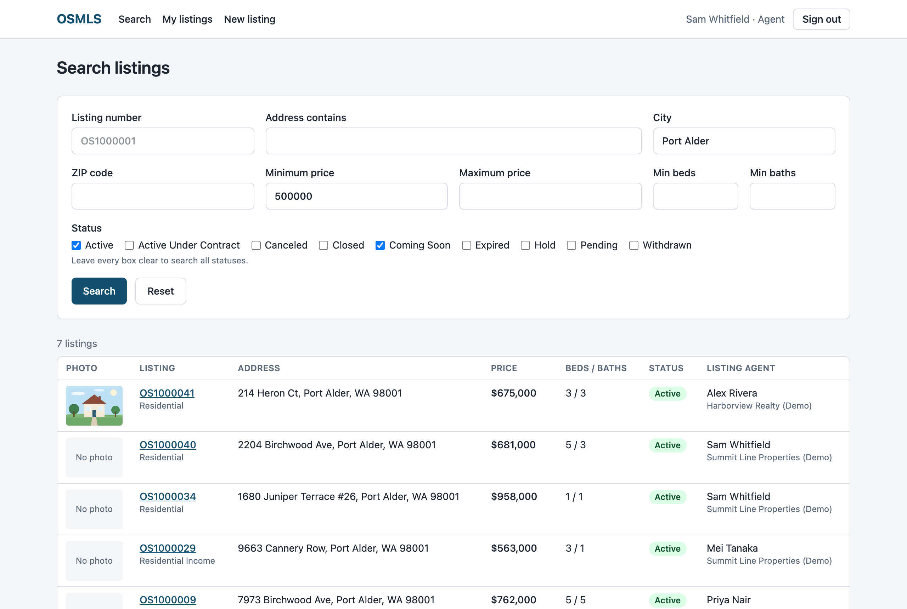

# OSMLS

OSMLS is a self-hosted, open-source multiple listing service (MLS) for real estate
professionals and the organizations that support them.

- **Agents** enter and update listings, search active and sold properties on a list
  or a map, research comparable sales, keep saved searches, and share listings with
  clients.
- **MLS staff** manage members and offices, review compliance flags, and correct
  listings with an audit trail.
- **Operators** get a standards-based data feed, file import and export, backup and
  recovery, and monitoring.

It is a working application. Run it locally with sample data to evaluate those
workflows, or use it as a foundation for your own MLS. [Status](#status) says what
has and has not been validated.



## Try it

You need [Docker](https://docs.docker.com/get-docker/).

```bash
docker compose up --build
```

Open http://localhost:3000 and sign in with a demo account. The password for all of
them is the `DEMO_PASSWORD` value in [.env.example](.env.example).

| Account | Role |
| --- | --- |
| `alex.rivera@osmls.example` | Agent, Harborview Realty (Demo) |
| `sam.whitfield@osmls.example` | Agent, Summit Line Properties (Demo) |
| `jordan.okafor@osmls.example` | Agent, Harborview Realty (Demo), the same office as Alex |
| `morgan.ellis@osmls.example` | MLS staff, holding every capability |
| `riley.chen@osmls.example` | Suspended agent: can sign in, but is refused everything |

- **Ports.** If port 3000 is taken, use another:
  `OSMLS_PORT=3300 docker compose up --build`. The database is published on port
  5433; change that with `OSMLS_DB_PORT`, and match it in `.env` if you develop
  locally.
- **Email.** What the demo "sends" is caught, not delivered. Read it at
  http://localhost:8025 (`OSMLS_MAIL_PORT` and `OSMLS_SMTP_PORT` move the mail
  catcher's ports).
- **Secrets.** The ones in `docker-compose.yml` and `.env.example` are for local
  demos only.

### A five-minute walkthrough

1. Sign in as **Alex Rivera**. Choose **New listing**, fill it in, and create it.
   Then choose **Edit listing**, upload a photo, and change the price. Note the
   listing number.
2. Sign out and sign in as **Sam Whitfield**. Search for the listing number and open
   the listing. Sam can read it but cannot edit it or see its history.
3. Sign out and sign in as **Morgan Ellis**. Open the same listing: the change
   history at the bottom shows who entered it, the price change with old and new
   values, and the photo. Choose **Correct listing**, change a field, and try to
   save without a reason.

The search opens showing Active and Coming Soon listings. Clear every status box to
search every status.

To try market research, search for "Comparable Ct" with Closed ticked to see recent
sales, open "1 Comparable Ct" and choose **Find comparables**. Listings on
"Relist Rd" show how cumulative days on market carry across a relisting, and when
they do not.

## What you can do

### As an agent

- **Enter and maintain listings.** Required fields and formats are validated, only
  permitted status changes are allowed, and every change is recorded.
- **Attach photos and documents**, with showing instructions, and choose who may see
  each document.
- **Search** by listing number, address, city, ZIP code, price, bedrooms, bathrooms,
  status and closing details, in a table or on a map.
- **Research the market.** Find comparable sales for a listing, and see days on
  market counted by rules your MLS sets.
- **Keep saved searches and collections**, see what has changed since you last
  looked, and have that emailed to you daily or weekly.
- **Print reports** for yourself or a client, and export a search to a CSV file.
- **Share with clients.** Give a client a link to one listing or a collection. Links
  expire, can be revoked, and show only the fields meant for clients.

Details: [agent workflows](docs/agent-workflows.md).

### As MLS staff


- **Manage members.** Add a member, change their details and role, and suspend or
  reinstate their access, each with a record of who did it and why.
- **Manage offices and brokerages**, including moving an agent between them.
- **Divide administration between staff.** Seven separate permissions decide what
  each staff account may do.
- **Set how market time is counted** for your MLS. Each change is kept as a version.
- **Review compliance flags** on listings, and say which earlier listing a relisting
  continues.
- **Correct any listing**, with a required reason. The change history shows who
  changed each field, the old and new values, and when. The database refuses any
  attempt to edit or delete it.

Details: [administration](docs/administration.md).

### As an operator or integrator

- **Serve a data feed.** A read-only RESO Web API endpoint, using RESO Data
  Dictionary 2.1 field names, for outside systems holding a token you issue. A
  full feed and a narrower public one are provided. It is not RESO certified: see
  [Status](#status).
- **Import new listings** from a CSV file, with a preview before anything is
  created. The importer creates new listings only. It cannot migrate an existing
  MLS's historical records.
- **Back up and restore** the database and the uploaded files together, as one
  consistent state, and check the restored copy against what was saved.
- **Watch the installation.** Two health checks, a record of every backup and
  scheduled run, an email when something is wrong, and an Operations screen for
  staff. It cannot report that its own machine or database is down; a monitor
  outside the installation is needed for that.
- **See what was measured.** How many listing changes are committed a second, and
  how long each waits, measured on one laptop with the method and limits stated.

Details: [data exchange](docs/data-exchange.md) and [operations](docs/operations.md).

## Status

OSMLS is a working, self-hosted MLS application, available for local evaluation.
It is **not production-ready**.

- **Validated locally.** The workflows above are covered by automated tests that run
  on each change, in Chromium on Linux, with synthetic data. All people, offices and
  listings in the demo are synthetic.
- **Not yet used by a real MLS.** There is no hosted instance, and it has had no
  security review.
- **Not RESO certified.** Only RESO certifies, and OSMLS has not been submitted.
  RESO's own certification tool has been run against a local instance, with the
  results and limits given in the [data exchange guide](docs/data-exchange.md). A
  local run is not a certification.
- **Not built.** Client accounts and scheduled email to clients, brokerage-wide
  access, self-service password reset, migrating an existing MLS's historical
  records, and fair-housing checks on remarks.

[CHARTER.md](CHARTER.md) records the project's purpose, its decisions and scope, and
what is deferred.

## Documentation

| Guide | Covers |
| --- | --- |
| [Agent workflows](docs/agent-workflows.md) | Listings, search and maps, documents, market research, saved work, reports, sharing and alerts |
| [Administration](docs/administration.md) | Members, offices, staff permissions, market-time settings, compliance flags |
| [Data exchange](docs/data-exchange.md) | The RESO Web API feed, file export, importing new listings |
| [Operations](docs/operations.md) | Backup and recovery, monitoring, performance measurement |
| [Development](docs/development.md) | Running it for development, tests, how it is built, the data model |

Each guide states the limits of what it describes, beside the feature they apply to.

## Develop

You need Node.js 22 or later, [pnpm](https://pnpm.io/), and Docker.

```bash
cp .env.example .env
pnpm install
docker compose up -d db mail   # PostgreSQL on localhost:5433, mail catcher on 1025 (read it at :8025)
pnpm db:migrate
pnpm db:seed
pnpm dev
```

It is one Next.js application in TypeScript with PostgreSQL, and needs no hosted
services. Tests, how it is built, and the data model are in the
[development guide](docs/development.md).

## Creator and maintainer

OSMLS is created and maintained by [Daniel P. Harris](https://danielpharris.com)
([GitHub](https://github.com/DanielPHarris)). Daniel held senior leadership roles at
Las Vegas REALTORS®, including Chief Technology Officer, Chief Innovation Officer,
and Chief Operating Officer, and served in interim CEO leadership; that experience
shapes OSMLS's priorities of practical agent workflows, MLS administration,
interoperability between vendors, and an accountable record of who changed what.

OSMLS is an independent project. It is not affiliated with or endorsed by Las Vegas
REALTORS® or the Real Estate Standards Organization (RESO), and contains none of
RESO's code or files.

## Contributing

Contributions are welcome. See [CONTRIBUTING.md](CONTRIBUTING.md).

## License

[Apache License 2.0](LICENSE). Copyright 2026 Daniel P. Harris.
