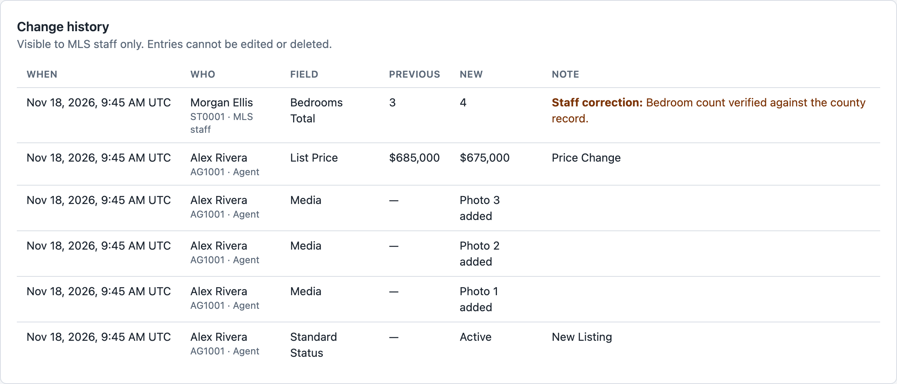

# OSMLS

An open-source MLS platform, created by Daniel P. Harris.

OSMLS is a focused core MLS: the functions people need for everyday work, built as
complete, tested workflows rather than a long list of unfinished features. It is not
an attempt to match the feature set of commercial MLS systems.

## Status

**Version 0.1, in development. Not production-ready.**

- It has not been used by a real MLS and has had no security review.
- It is **not RESO certified** and has not been run through RESO's certification
  tests. Field names follow the RESO Data Dictionary 2.0; there is no RESO Web API
  endpoint yet.
- All people, offices, and listings in the demo are synthetic.

[CHARTER.md](CHARTER.md) records the project's purpose, decisions, scope, and what
remains.

## Screenshots

From the demo, which uses synthetic listings and illustrated placeholder photos.

**An agent searches listings**


**Map search** (added after 0.1)


**A listing, as MLS staff see it**


**Its change history, including a staff correction**



## What version 0.1 does

One workflow, end to end:

1. **An agent creates a listing.** Required fields and formats are validated. Only
   permitted status changes are allowed. Photos can be uploaded.
2. **Another agent finds it.** Search by listing number, address, city, ZIP code,
   price range, bedrooms, bathrooms, and status, then open the full listing.
3. **MLS staff inspect its history.** Every change records who made it, when, the
   field, and the old and new values. Staff can correct any listing, but must give a
   reason, and the correction is marked as such.

Rules behind it:

- A listing agent can change only their own listings, and not once a listing is
  Closed, Canceled, or Expired. After that, only a staff correction can change it.
- History is written in the same database transaction as the change it describes.
  The database refuses any attempt to edit or delete a history row.
- Photos and listings are visible only to signed-in, active members.

### Added since 0.1: map search

- **Pin a listing.** On the listing form, click the map to place a pin or drag it to
  move it. Latitude and longitude fields show the same position and can be typed
  instead. A location is optional, but it is both coordinates or neither. Changes
  are recorded in the listing's history.
- **See results on a map.** The search page shows a pin for each matching listing
  that has a location. Selecting a pin shows the address, price, and status, with a
  link to the listing. Pins can be reached and opened from the keyboard, and every
  listing on the map is also in the results table.
- **Search this area.** Limits results to the part of the map on screen, together
  with every other filter. The area is kept in the page address, so a search can be
  reloaded or shared with another member.
- **Listings with no location** appear in ordinary searches marked "Location
  unavailable". An area search leaves them out, and says how many, because they
  cannot be placed inside the area.
- **If the map cannot be loaded,** the search form, the results table, and the
  listing form all keep working, and the page says the map is unavailable.

Not included: drawing shapes or radius circles, turning an address into a location
automatically, boundary layers, and map areas that cross the 180th meridian.

#### The map service

The map is drawn with [MapLibre GL JS](https://maplibre.org/). Where the map itself
comes from is one setting, `MAP_STYLE_URL`, which takes any MapLibre-compatible
style URL.

- If it is not set, OSMLS uses [OpenFreeMap](https://openfreemap.org/)'s public
  service, which needs no account or key. **That service comes with no availability
  guarantee and may be discontinued without notice.** It is a default for demos.
  Anyone running OSMLS for real use should choose a map tile service suited to
  their needs, self-hosted or managed, and set `MAP_STYLE_URL` to it.
- The map's credit line comes from the style (for the default: OpenFreeMap,
  OpenMapTiles, and OpenStreetMap) and is always shown in full. Keep it.
- When a member views a map, their browser requests map tiles directly from the
  map service. No listing data is sent to it.
- In the demo data, the towns are invented and pins are arbitrary points. They do
  not mark real properties.

### Not yet built

Documents, showing instructions, sold-record research and comparables,
days-on-market calculations, saved searches, alerts, email sharing, reports,
administration screens, compliance flags, imports and exports, a RESO Web API
endpoint, fair-housing checks on remarks, password reset, and production operations
(monitoring, backups, recovery). See the charter for the planned order.

## Try it

You need [Docker](https://docs.docker.com/get-docker/).

```bash
docker compose up --build
```

Open http://localhost:3000. If port 3000 is taken, use another:
`OSMLS_PORT=3300 docker compose up --build`. The database is published on port 5433;
change that with `OSMLS_DB_PORT` (and match it in `.env` if you develop locally).

Sign in with a demo account. The password for all of them is the `DEMO_PASSWORD`
value in [.env.example](.env.example).

| Account | Role |
| --- | --- |
| `alex.rivera@osmls.example` | Agent, Harborview Realty (Demo) |
| `sam.whitfield@osmls.example` | Agent, Summit Line Properties (Demo) |
| `morgan.ellis@osmls.example` | MLS staff |

The secrets in `docker-compose.yml` and `.env.example` are for local demos only.

### Walkthrough

1. Sign in as **Alex Rivera**. Choose **New listing**, fill it in, and create it.
   Then choose **Edit listing**, upload a photo, and change the price. Note the
   listing number.
2. Sign out and sign in as **Sam Whitfield**. Search for the listing number and open
   the listing. Sam can read it but cannot edit it or see its history.
3. Sign out and sign in as **Morgan Ellis**. Open the same listing: the change
   history at the bottom shows who entered it, the price change with old and new
   values, and the photo. Choose **Correct listing**, change a field, and try to
   save without a reason.

The search opens showing Active and Coming Soon listings. Clear every status box to
search all 40.

## Develop

You need Node.js 22 or later, [pnpm](https://pnpm.io/), and Docker.

```bash
cp .env.example .env
pnpm install
docker compose up -d db     # PostgreSQL on localhost:5433
pnpm db:migrate
pnpm db:seed
pnpm dev
```

### Tests

```bash
pnpm test                                # rules, validation, and database behaviour
pnpm exec playwright install chromium    # once, to download the test browser
pnpm test:e2e                            # the 0.1 workflow and map search in a real browser
pnpm lint && pnpm typecheck
```

Every pull request, and every push to `main`, runs these same commands plus a
production build on GitHub
([.github/workflows/checks.yml](.github/workflows/checks.yml)), in Chromium on
Linux.

Tests use their own database (`TEST_DATABASE_URL`), which is deleted, re-created,
and seeded on the same PostgreSQL server at the start of every run. They never write to the development or
demo database. The browser tests start their own server on port 3210 and use a blank
local map style, so they do not depend on an outside map service. The default map
service was checked by hand in a production build, at desktop and phone widths.

## How it is built

- **TypeScript**, one **Next.js** application, **PostgreSQL**. No hosted services
  are required to run it.
- Schema changes are SQL migrations in [drizzle/](drizzle/), generated from
  [src/db/schema.ts](src/db/schema.ts).
- Listing logic, permissions, and history live in
  [src/lib/listings.ts](src/lib/listings.ts).
- Operating rules an MLS would want to change are kept apart from the rest:
  permitted status changes in [src/lib/rules/status.ts](src/lib/rules/status.ts),
  local formats, limits, and where maps open in
  [src/lib/rules/local.ts](src/lib/rules/local.ts).
- A listing's location is two plain numeric columns, `Latitude` and `Longitude`.
  PostGIS is not used.

### Data model

Tables and columns are named after RESO Data Dictionary 2.0 resources and fields:
`Property`, `Member`, `Office`, `Media`, and `HistoryTransactional`. Lookup values
such as `StandardStatus` use the Data Dictionary's display names.

Columns that are not in the Data Dictionary start with `Osmls`:

| Column | Purpose |
| --- | --- |
| `Member.OsmlsRole` | `agent` or `staff` |
| `Member.OsmlsUserId` | Links a member to their sign-in account |
| `Property.OsmlsLocalFields` | Reserved for an MLS's own fields; not used yet |
| `Media.OsmlsStoragePath` | File name of the stored photo |
| `HistoryTransactional.OsmlsStaffCorrection` | Whether MLS staff made the change |
| `HistoryTransactional.OsmlsCorrectionReason` | The reason staff gave |

"Listing agent" is not a separate role. It is the agent named in `ListAgentKey` on a
given listing.

OSMLS is an independent project. It is not affiliated with or endorsed by the Real
Estate Standards Organization, and contains none of RESO's code or files.

## Contributing

Contributions are welcome. See [CONTRIBUTING.md](CONTRIBUTING.md).

## License

[Apache License 2.0](LICENSE). Copyright 2026 Daniel P. Harris.
